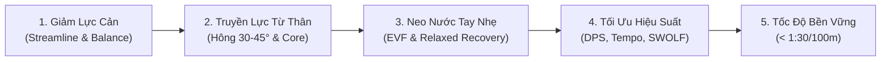

# Freestyle Swimming Mastery (`swim-book`)

> **Bộ sách chuyên khảo & Cơ sở tri thức Markdown về Bơi Sải Hiện Đại**  
> **Triết lý cốt lõi:** *Tốc độ cao – Tay nhẹ – Truyền lực từ thân (Core + Hông)*

---

## 1. Giới thiệu

`Freestyle Swimming Mastery` là bộ tài liệu kỹ thuật bằng tiếng Việt (kèm hệ thuật ngữ chuẩn quốc tế), được thiết kế theo văn phong **sách kỹ thuật MIT** và kiến trúc **AI-Ready Knowledge Base**.

Thay vì học bơi theo cảm tính hoặc "kéo tay thật mạnh", bộ sách đi từ **nguyên lý vật lý chất lưu, cơ sinh học khớp vai–hông–core và sinh lý năng lượng** để giúp người bơi ở mọi cấp độ đạt được trạng thái:
- **Tay nhẹ, vai không mỏi** nhờ dựng cẳng tay sớm (*Early Vertical Forearm — EVF*) và pha rút tay trên không thả lỏng.
- **Thân dài, nước êm, ít bọt** nhờ giảm tối đa lực cản hình học và lực cản sóng ($F_d \propto v^2$).
- **Tốc độ bền vững** với mục tiêu thực chiến tiến tới mốc **`< 1:30/100m`** thông qua giáo án 24 tuần, hệ thống Drill chuẩn quốc tế và quy trình phân tích video bằng AI.

---

## 2. Đọc nhanh & Bắt đầu từ đâu?

| Nhu cầu của bạn | File nên mở trước |
| :--- | :--- |
| Muốn nắm ngay bản tóm tắt kỹ năng thực chiến tại hồ | [skill.md](skill.md) |
| Muốn xem toàn bộ mục lục 24 chương & 8 kho tri thức | [SUMMARY.md](SUMMARY.md) |
| Muốn tra cứu nhanh thuật ngữ bơi sải Anh–Việt | [24-appendix/glossary.md](24-appendix/glossary.md) |
| Muốn theo dõi tiến độ biên soạn 12 Phase | [TASKS.md](TASKS.md) |
| Là AI Agent / Cộng tác viên tham gia viết bài | [PROJECT.md](PROJECT.md), [STYLE.md](STYLE.md), [AGENT_RULES.md](AGENT_RULES.md), [QUALITY.md](QUALITY.md) |

---

## 3. Cấu trúc dự án

Dự án gồm **3 tầng kiến trúc** (xem chi tiết tại [DIRECTORY.md](DIRECTORY.md)):

1. **Tầng Điều Phối (Governance — 8 file gốc)**: `PROJECT.md`, `STYLE.md`, `OUTPUT.md`, `DIRECTORY.md`, `TASKS.md`, `FILE_TEMPLATE.md`, `AGENT_RULES.md`, `QUALITY.md`.
2. **Tầng Nội Dung Chuyên Khảo (24 thư mục)**: Từ `01-foundation/` (Vật lý, Cơ sinh học, Thủy động lực học) → `04-body-position/` đến `14-stroke-count/` (Kỹ thuật & Hiệu suất) → `15-open-water/` đến `22-training-plan/` (Thi đấu, Drill, Dryland, AI Analysis, Giáo án 24 tuần) → `23-checklists/` & `24-appendix/`.
3. **Tầng Knowledge Base Mở Rộng (8 kho tri thức)**: `papers/`, `images/`, `mermaid/`, `videos/`, `datasets/`, `coach-notes/`, `athletes/`, `benchmarks/`.

---

## 4. Tương thích đa nền tảng xuất bản

Toàn bộ tài liệu sử dụng **Markdown chuẩn (CommonMark / GFM)** + **Mermaid** + **LaTeX**, tương thích trực tiếp với:
- **Obsidian**: Mở trực tiếp thư mục `swim-book/` như một Vault.
- **GitBook / mdBook**: Sử dụng trực tiếp file [SUMMARY.md](SUMMARY.md) làm mục lục xuất bản web/PDF.
- **MkDocs / Hugo**: Đưa vào thư mục `docs/` hoặc `content/` với cấu trúc thư mục đánh số tuyến tính.
- **AI Agents (Antigravity, Codex, Claude Code)**: Đọc 8 file Governance ở root để tự động sinh, biên tập và kiểm duyệt từng Phase theo [TASKS.md](TASKS.md).

---

## 5. Cổng kiểm duyệt chất lượng

Mọi chương hoàn thiện đều phải vượt qua **14 tiêu chí** tại [QUALITY.md](QUALITY.md), bảo đảm mỗi file đều có: *Nguyên lý khoa học, Sơ đồ Mermaid, Bảng biểu, Drill, Lỗi & Cách sửa, KPI, Checklist, FAQ, Summary và Tài liệu tham khảo*.

