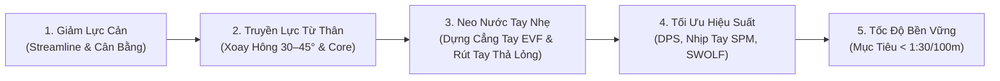
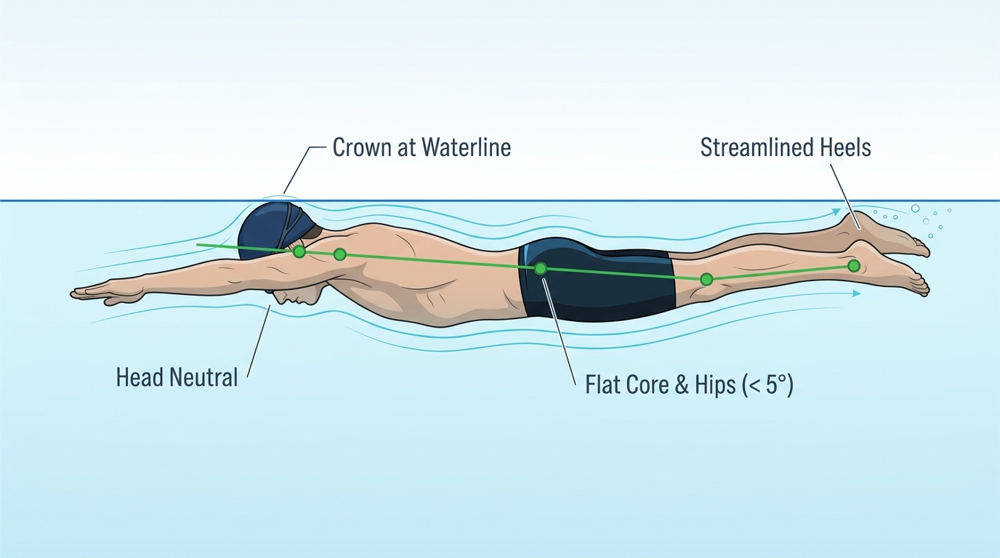
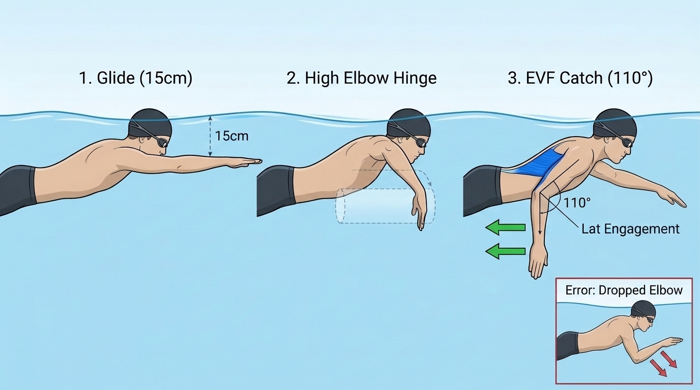
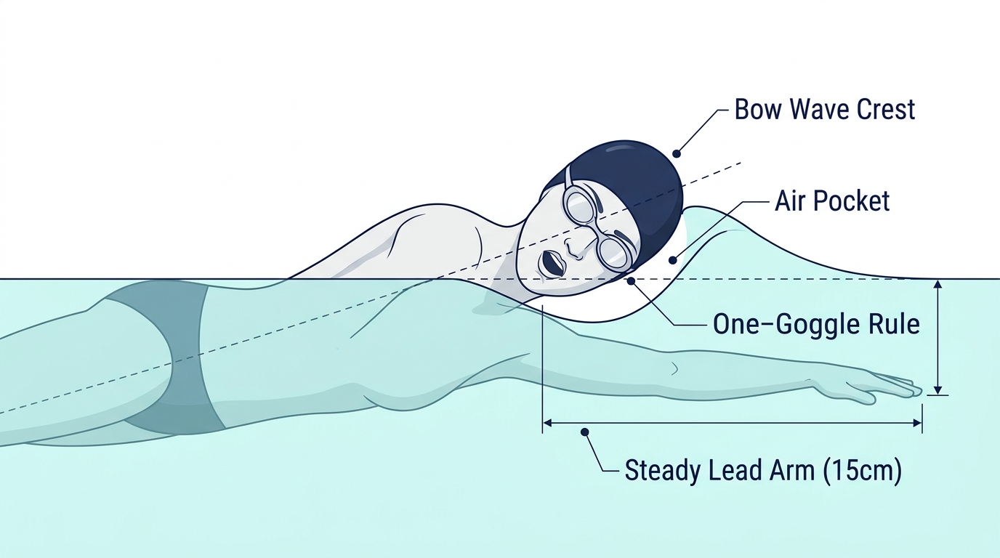
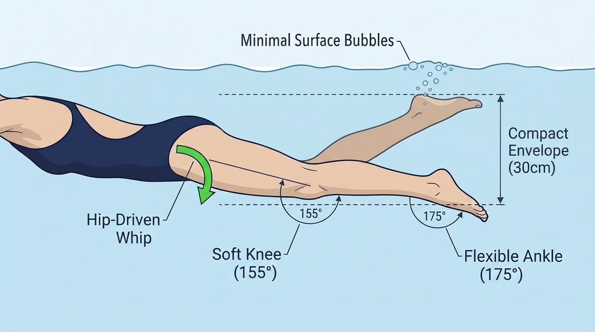
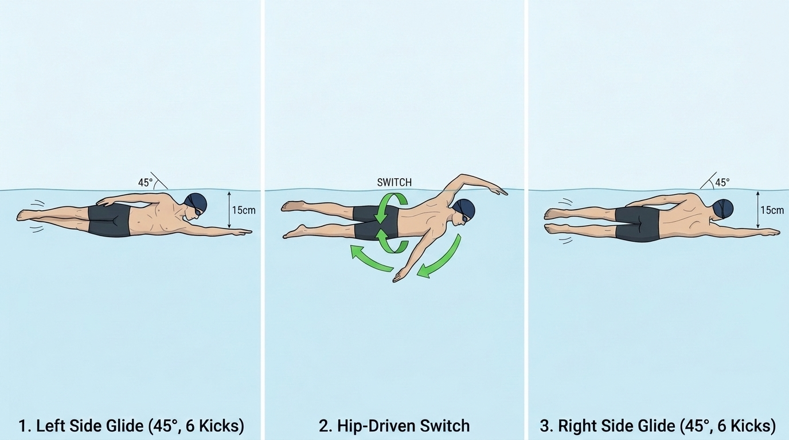
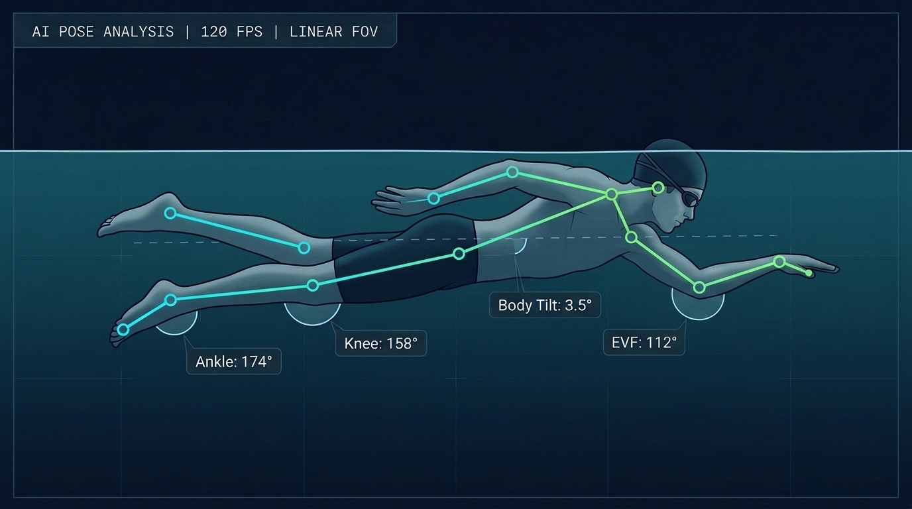

# 🏊 Làm Chủ Bơi Sải Hiện Đại (`Freestyle Swimming Mastery`)

[-009688?style=for-the-badge)](TASKS.md)
[-0288D1?style=for-the-badge)](SUMMARY.md)
[](images/README.md)
[](Home.md)

> **Bộ sách chuyên khảo & Cơ sở tri thức Markdown (AI-Ready Knowledge Base) về Bơi Sải Hiện Đại bằng Tiếng Việt (kèm chú thích thuật ngữ Tiếng Anh chuẩn quốc tế).**  
> **Triết lý cốt lõi:** *Bơi tốc độ (`< 1:30/100m`) – Tay nhẹ không mỏi vai – Truyền lực từ thân (`Core + Hông`).*

---

## 1. Triết Lý Cốt Lõi: Tại Sao Bơi Bằng Thân Lại Nhanh & Nhẹ Hơn Bơi Bằng Tay?

Nước có mật độ đặc gấp **~800 lần không khí**. Lực cản nước tăng theo bình phương vận tốc ($F_d \propto v^2$) và công suất tiêu hao tăng theo lập phương vận tốc ($P \propto v^3$). Vì vậy, thay vì gồng vai quạt tay thật mạnh, bộ sách này xây dựng kỹ năng bơi sải theo đúng **5 tầng khoa học chuẩn MIT**:



- **Chuỗi truyền lực chuẩn (Kinetic Chain):** `Chân (Ổn định) → Hông (Xoay 30–45°) → Cơ Lõi (Core) → Vai & Cơ Xô (Lat) → Cẳng Tay (EVF) → Nước`.
- **Tay nhẹ, vai bền:** Huy động nhóm **cơ lưng rộng (Latissimus Dorsi)** nhờ dựng cẳng tay sớm (*Early Vertical Forearm — EVF*) và thả lỏng 100% cổ tay ở pha rút tay trên không (*Relaxed Recovery*).
- **Đo lường khoa học:** Không tập theo cảm tính — mọi buổi bơi đều được định lượng qua **SWOLF**, **DPS** (*Quãng đường mỗi sải*), **SPM** (*Nhịp tay/phút*), **CSS** (*Tốc độ ngưỡng hiếu khí*) và **Phân tích Video AI**.

---

## 2. Xem Trước Bộ 12 Hình Minh Họa Cơ Sinh Học & Bài Tập (PNG)

Toàn bộ các kỹ thuật cốt lõi và bài tập (Drills) đều có sơ đồ trực quan độ phân giải cao trong [Thư Viện Hình Minh Họa (`images/`)](images/README.md):

| Tư Thế Thân Ngang (`< 5°`) | Dựng Cẳng Tay Sớm (`EVF 110°`) |
| :---: | :---: |
|  |  |
| **Thở Hõm Sóng Mũi (*One-Goggle*)** | **Đạp Chân Roi Da Từ Hông (`6-Beat`)** |
|  |  |
| **Bài Tập 6-Kick Switch (`45°`)** | **Phân Tích Khung Xương AI (*Pose Detection*)** |
|  |  |

*(Còn 6 hình minh họa chi tiết khác về **Streamline sâu 0.6m**, **3-Position Sculling**, **Fingertip Drag**, **Wide Catch-Up**, **Flip Turn 4 bước** và **Dryland Core 4 trụ cột** tại [images/README.md](images/README.md)).*

---

## 3. Chọn Nhanh Lộ Trình Đọc Theo Mục Tiêu Của Bạn

| Bạn thuộc nhóm nào? | Bắt đầu ngay từ các tài liệu sau |
| :--- | :--- |
| **Người muốn ôn nhanh 3 phút trước khi xuống hồ** | [Bản Tóm Tắt Thực Chiến (`skill.md`)](skill.md) · [Bảng Tra Cứu Lỗi → Drill](24-appendix/drills-index.md) |
| **Người mới học bơi / Hay chìm hông & hụt hơi** | [Trọng Tâm & Tâm Nổi](01-foundation/center-of-gravity-and-buoyancy.md) → [Tư Thế Thân](04-body-position/body-position-and-alignment.md) → [Kỹ Thuật Thở](07-breathing/breathing-mechanics.md) |
| **Người bơi phong trào muốn phá mốc `< 1:30/100m`** | [Dựng Cẳng Tay EVF](09-catch/early-vertical-forearm.md) → [SWOLF & CSS](14-stroke-count/swolf-and-energy-systems.md) → [Giáo Án 24 Tuần](22-training-plan/overview-and-css-testing.md) |
| **Triathlete & Bơi Nước Mở (Open Water)** | [Chân 2 Nhịp (2-Beat Kick)](08-kicking/two-beat-kick.md) → [Kỹ Thuật Nước Mở (Sighting & Drafting)](15-open-water/open-water-skills.md) → [Katie Ledecky](athletes/katie-ledecky.md) |
| **Người hay đau vai / Dân văn phòng cứng khớp** | [Cơ Sinh Học Vai & Cơ Xô](02-biomechanics/shoulder-and-lat-mechanics.md) → [Linh Hoạt Vai, Lưng Ngực & Cổ Chân](19-mobility/shoulder-thoracic-ankle-mobility.md) |
| **Huấn luyện viên & Nghiên cứu AI Video** | [Bảng Chấm Điểm HLV](23-checklists/coach-evaluation.md) → [Quy Trình Quay 4 Góc](21-video-analysis/filming-and-annotation-workflow.md) → [AI Pose Detection](20-ai-analysis/pose-and-joint-angle.md) |

---

## 4. Kiến Trúc Bộ Sách & Kho Tri Thức (Knowledge Base)

Xem mục lục chi tiết toàn bộ **24 chương chuyên khảo + 8 kho tri thức mở rộng** tại [Mục Lục Tổng (`SUMMARY.md`)](SUMMARY.md):

1. **Phần I — Nền Tảng Khoa Học (`01` → `03`):** Vật lý bơi ($P \propto v^3$), Trọng tâm & Tâm nổi (COG/COB), Chuỗi truyền lực, Cơ sinh học Vai–Cơ Xô, Giảm lực cản & Lực nâng Bernoulli.
2. **Phần II — Kỹ Thuật Cốt Lõi (`04` → `11`):** Tư thế thân ngang, Streamline, Cân bằng & Trượt, Kích hoạt Core, Xoay trục dọc `30–45°`, Kỹ thuật thở, Chân `2/4/6-Beat` + Cổ chân + Dolphin Kick, Vào nước "xỏ kim", EVF, Kéo–Đẩy và Rút tay thả lỏng.
3. **Phần III — Hiệu Suất, Thi Đấu & VĐV Olympic (`12` → `16`, `athletes/`):** Nhịp điệu Front-Quadrant (`IdC`), DPS, Stroke Count, Tempo (`SPM`), SWOLF/CSS, Open Water, Starts & Flip Turns, cùng hồ sơ phân tích **Caeleb Dressel, David Popovici, Katie Ledecky, Ian Thorpe, Sun Yang**.
4. **Phần IV — Hệ Thống Bài Tập, Tập Cạn & Giáo Án 24 Tuần (`17` → `19`, `22`):** Hệ thống Total Immersion / SwimSmooth / Olympic, 9 Drill kinh điển, Dryland Core/Lat/Mobility và **Giáo án 24 tuần đầy đủ cho 4 lịch tập (3, 4, 5, 6 buổi/tuần)**.
5. **Phần V — Phân Tích AI, Video, Checklists & Phụ Lục (`20`, `21`, `23`, `24`, `papers/`, `benchmarks/`, `coach-notes/`):** Pose Detection, Dataset Schema, Bảng tự chấm 100 điểm, Bảng chuẩn theo tuổi/giới/chiều cao, Tóm tắt 10 nghiên cứu khoa học và [Bảng Thuật Ngữ Song Ngữ Anh–Việt](24-appendix/glossary.md).

---

## 5. Hướng Dẫn Sử Dụng Trên Obsidian, Web (MkDocs) & AI Agent

- **Đọc trực tuyến trên Web (Miễn phí vĩnh viễn):** Mở trực tiếp tại [https://gadoi.github.io/boisaiskill/](https://gadoi.github.io/boisaiskill/) (giao diện **MkDocs Material** có tìm kiếm tiếng Việt, Dark/Light mode, sơ đồ Mermaid và công thức Toán MathJax).
- **Mở bằng Obsidian Vault:** Chọn **Open folder as vault** → trỏ tới thư mục repo này → mở [Home.md](Home.md) và nhấn `Ctrl + G` để khám phá **Graph View** phân 9 nhóm màu.
- **Chạy Web Sách Cục Bộ (Local):**
  ```bash
  pip install -r requirements-docs.txt
  mkdocs serve
  ```
- **Mở rộng cùng AI Agent (Antigravity, Codex, Claude Code):** Bộ 8 file quy chuẩn gốc ([PROJECT.md](PROJECT.md), [STYLE.md](STYLE.md), [OUTPUT.md](OUTPUT.md), [DIRECTORY.md](DIRECTORY.md), [TASKS.md](TASKS.md), [FILE_TEMPLATE.md](FILE_TEMPLATE.md), [AGENT_RULES.md](AGENT_RULES.md), [QUALITY.md](QUALITY.md)) đảm bảo mọi chương bổ sung đều đạt chuẩn 14 tiêu chí chất lượng.
