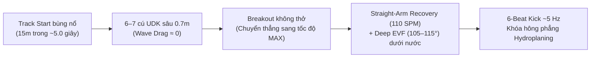

# Phân Tích VĐV Olympic: Caeleb Dressel — Đỉnh Cao Sprint, Start & Công Suất Bùng Nổ

> **Thuộc phần:** `athletes/` | **Cự ly sở trường:** 50m & 100m Freestyle | **Phong cách:** Explosive Shoulder-Driven Sprint

## Tổng Quan (Overview)
**Caeleb Dressel** (Hoa Kỳ — cao `1.91 m`, sải tay `1.98 m`, chủ nhân 9 HCV Olympic) đại diện cho đỉnh cao tuyệt đối của **bơi sải nước rút hiện đại (*Explosive Sprint Freestyle*)**. Nếu bạn muốn hiểu cách biến sức mạnh thân trên, pha xuất phát bùng nổ và **Underwater Dolphin Kick** thành tốc độ vượt `2.2 m/s`, kỹ thuật của Dressel là bản thiết kế hoàn hảo nhất — đồng thời cũng cho thấy rõ ranh giới những yếu tố nào người bơi phong trào *nên học* và yếu tố nào *không nên bắt chước mù quáng*.

- **Mục tiêu cốt lõi:** Giải mã 3 vũ khí tối thượng của Dressel: **Start & 15m Underwater Dolphin Kick**, **Straight-Arm / Hybrid Recovery tần suất cực cao (`100–115 SPM`)**, và **Deep EVF Catch kết hợp 6-Beat Kick**.
- **Bài học cho người bơi `< 1:30/100m`:** Học sự sắc bén của **Breakout không thở**, **tốc độ khóa EVF** và **sức mạnh Core giữ hông phẳng**; tránh sao chép tần suất `110 SPM` cho cự ly dài.
- **Đặc điểm nhận diện:** Cơ thể nổi cao lướt trên mặt nước (*Hydroplaning*), vai mở thoáng, gần như không thở trong 50m.

---

## Lý Thuyết (Theory)
Kỹ thuật của Dressel được xây dựng quanh mô hình **Shoulder-Driven Superposition Sprint** (`IdC > +5%`):
- Ở cự ly `50m` (`~21.0 giây`), mục tiêu không phải tiết kiệm năng lượng mà là **tối đa hóa công suất tức thời ($P_{\max}$) trên từng phần trăm giây**.
- Thay vì chờ pha trượt dài ở phía trước, Dressel dùng **tốc độ rơi của cánh tay thẳng trên không** kết hợp **xoay vai sắc gọn (`25–35°`)** để nạp lực lập tức vào pha Catch dưới nước, giữ cho lực đẩy không bao giờ ngắt quãng.

---

## Cơ Sở Khoa Học (Science)
### Vật Lý & Thủy Động Lực Học (Physics & Hydrodynamics)
- **Lợi thế Start & 15m ngầm (Nhanh nhất lịch sử bơi lội)**: Dressel chạm mốc `15 m` từ bục xuất phát chỉ trong **`4.9–5.1 giây`** (vận tốc trung bình gần `3.0 m/s`!). Anh thực hiện **6–7 cú Underwater Dolphin Kick** cực mạnh ở độ sâu `0.7–0.8 m` (nơi Wave Drag = 0) trước khi Breakout ngay vạch `15 m`.
- **Hiệu ứng Hydroplaning**: Nhờ động cơ **6-Beat Kick tần suất ~5 Hz** kết hợp công suất kéo khổng lồ, phần ngực và vai của Dressel nổi cao hẳn lên mặt nước, cắt giảm đáng kể diện tích bề mặt ướt (*Wetted Surface Area*).

### Cơ Sinh Học (Biomechanics)
- **EVF sâu và cực nhanh dưới nước**: Dù pha Recovery trên không của Dressel dùng cánh tay gần thẳng (*Straight-Arm Recovery*) ở 50m, nhưng **ngay khi chạm nước**, khuỷu tay anh lập tức gập về góc **`105–115°` (EVF sâu)** để huy động toàn bộ cơ lưng rộng (Lat) và cơ ngực lớn!
- **Core chống xoay cứng như thép**: Để chịu được mô-men văng của *Straight-Arm Recovery* ở `110 SPM` mà thân không bị lắc ngang, Dressel sở hữu sức mạnh Core và tỷ lệ cơ/mỡ thuộc hàng xuất chúng (bật nhảy tại chỗ *Vertical Jump* `> 105 cm`!).

---

## Thực Hành (Practical)
### Tại Sao Kỹ Thuật Này Hiệu Quả (Why It Works — Và Điều Bạn Nên Học)

Bạn **không cần** bật nhảy cao 1 mét hay quạt 110 SPM để hưởng lợi từ phong cách Dressel. 3 bài học thực chiến mang lại tốc độ ngay lập tức cho người bơi phong trào:
1. **Biến 5–8m sau mỗi thành bể thành đoạn nhanh nhất**: Giữ Streamline khóa chặt + 3 cú Dolphin Kick gọn + Breakout không thở.
2. **Đừng sợ tăng Tempo ở 25–50m cuối**: Khi cần nước rút phá mốc `< 1:30/100m`, chủ động đẩy SPM lên cao và chuyển sang `IdC > 0%` (tay này chưa dứt Push tay kia đã bắt Catch).
3. **Tập trung vào tốc độ phát lực (*RFD*) trên cạn**: Pull-Up bùng nổ, Box Jump, Medball Slam giúp tăng độ sắc của cú đạp tường và pha Push.

### Hướng Dẫn Từng Bước & Cảm Giác Nước (Step-by-Step & Water Cues)
1. **Học Breakout sắc bén**: Đạp tường sâu `0.6 m`, 3 cú Dolphin Kick nhanh gọn, tung sải tay đầu tiên mạnh mẽ ngay khi đầu vừa phá mặt nước mà **không xoay đầu thở**.
2. **Giữ EVF sâu dù tăng tốc**: Khi tăng nhịp tay lên `80–90 SPM` ở các bài `25m Sprint`, giữ kỷ luật không để khuỷu tay trượt phẳng — vẫn phải cảm thấy khối nước đặc trên cẳng tay.
3. **Khóa Core chống lắc khi tăng tốc**: Siết chắc cơ bụng và giữ 6-beat kick gọn dưới mặt nước.

<!-- IMAGE_PROMPT: Technical sports biomechanics breakdown of Caeleb Dressel's 50m freestyle sprint: underwater side view highlighting 15m dolphin kick trajectory, hydroplaning chest lift, 110-degree deep EVF catch under water despite straight-arm above-water recovery, and compact 6-beat kick envelope. -->

### Mẹo Nâng Cao (Advanced Tips)
- **Phân biệt 50m vs 100m của chính Dressel**: Ở cự ly `100m`, chính Dressel cũng hạ nhịp tay xuống `~90–96 SPM`, sử dụng pha Recovery hơi gập khuỷu tự nhiên hơn (*Hybrid Recovery*) ở 50m đầu để giữ sức cho 50m về đích!

---

## Bài Tập Thực Hành (Drills — Mô Phỏng Vũ Khí Của Dressel)

| Tên Drill | Kỹ năng học từ Dressel | Cự ly / Số hiệp | Cảm giác đúng (Cue) |
| :--- | :--- | :--- | :--- |
| **15m Underwater Breakout Sprint** | Tối đa hóa tốc độ sau tường & chuyển pha không thở | `6 × 25m` (10m UDK + 15m Sprint, nghỉ 45s) | Thoát tường êm sâu `0.6 m`, trồi lên vọt thẳng không khựng |
| **25m Superposition Sprint** | Làm quen nhịp tay cao (`IdC > 0%`) + 6-beat kick | `6 × 25m` @ 95% (nghỉ 45s) | Chân 6-beat sôi gọn, tay kéo dứt khoát không để Dead Spot |
| **Explosive Box Jump + Band Pull (Dryland)** | Phát triển sức mạnh bật đạp tường & pha Push | `3 × 6 Box Jump` + `3 × 10 Fast Band Pull` | Bật cao dứt khoát, kéo dây tăng tốc tối đa |

---

## Phân Tích AI & Video (AI Analysis)
- **Thông số chuẩn mẫu của Caeleb Dressel (50m LCM Final):**
  - Thời gian `15m Start`: `~5.0 s` | `SPM`: `108–116` | `DPS`: `~1.05–1.12 m/sải` (SL `~2.15 m/chu kỳ`) | `IdC`: `+5% đến +10%` | `Kick`: 6-Beat liên tục.
- **So sánh tự động trên video người tập:** Kiểm tra xem khi tăng tốc độ lên `95%`, góc khuỷu EVF có giữ được `≤ 120°` giống Dressel hay bị sụp thẳng ra `> 150°`.

---

## Lỗi Thường Gặp & Cách Sửa (Common Errors — Khi Bắt Chước Dressel)

| Lỗi thường gặp | Triệu chứng nhận biết | Nguyên nhân gốc | Cách sửa (Correction) |
| :--- | :--- | :--- | :--- |
| **Dùng Straight-Arm Recovery khi vai còn cứng** | Đau nhói mặt trước khớp vai sau vài buổi | Thiếu độ linh hoạt vai & sức mạnh Core như VĐV Olympic | Dùng **High-Elbow Relaxed Recovery** cho 95% khối lượng tập luyện |
| **Đẩy SPM lên > 95 nhưng mất sạch EVF** | Quạt tay điên cuồng, bọt trắng xóa, tốc độ không tăng | Chưa có nền sức mạnh cơ xô và cảm giác nước chắc | Chỉ tăng SPM đến đúng ngưỡng giữ được EVF (`Ramp Test`) |
| **Áp dụng nhịp Sprint 50m cho cự ly 400m+** | Kiệt sức hoàn toàn sau 75m đầu tiên | Nhầm lẫn hệ năng lượng kỵ khí (Z5) với hiếu khí (Z2–Z3) | Dùng mô hình Dressel cho Sprint `25–100m`, dùng Popovici/Ledecky cho đường dài |

---

## Tự Đánh Giá Tại Hồ (Self Assessment)
- [ ] Tôi hiểu rõ vì sao Straight-Arm Recovery của Dressel vẫn đi kèm **Deep EVF dưới nước**.
- [ ] Tôi áp dụng được kỹ thuật **Breakout không thở** sau mỗi lần đạp tường trong bài tập tốc độ.
- [ ] Tôi không mù quáng sao chép `110 SPM` vào các bài bơi bền `400m–1.500m`.
- [ ] Tôi biết cách chuyển sang nhịp tay cao + 6-beat kick ở `25–50m` nước rút cuối cùng.

---

## Chỉ Số Đo Lường (KPI — Tham Chiếu Dressel vs Mục Tiêu Phong Trào `< 1:30/100m`)

| Chỉ số (Metric) | Chuẩn Caeleb Dressel (50m/100m) | Mục tiêu Phong trào (`< 1:30/100m`) |
| :--- | :---: | :---: |
| **15m Start / Wall Breakout** | `5.0 s` (từ bục) | `7.5–9.0 s` (từ tường) |
| **Stroke Rate (SPM) khi nước rút 50m** | `105–116 SPM` | `78–88 SPM` |
| **Góc khuỷu EVF dưới nước** | `105–115°` | `105–120°` |
| **Số lần thở trong 50m Sprint** | `0–1 lần` | `2–4 lần` (an toàn oxy) |

---

## Câu Hỏi Thường Gặp (FAQ)
**1. Người bơi phong trào có nên tập Straight-Arm Recovery giống Dressel không?**
Chỉ nên thử nghiệm ở các đoạn nước rút ngắn `25m` nếu bạn có **độ linh hoạt vai rất tốt (không đau vai)** và **6-beat kick khỏe**. Cho mục tiêu bơi đường dài và `< 1:30/100m` bền bỉ, High-Elbow Recovery vẫn ưu việt hơn.

**2. Yếu tố nào của Dressel dễ áp dụng và mang lại hiệu quả tức thì nhất cho tôi?**
Chính là **tính kỷ luật trong Streamline + Dolphin Kick + Breakout không thở** ở mọi thành bể!

---

## Tóm Tắt (Summary)
- **Caeleb Dressel** là hình mẫu tối thượng của **Start/UDK bùng nổ**, **Hydroplaning 6-Beat** và **Deep EVF tốc độ cao**.
- Bài học cốt lõi: Khai thác triệt để giai đoạn bơi ngầm sau tường, khóa Core cứng khi tăng tốc và luôn giữ EVF sâu ngay cả ở tốc độ Sprint tối đa.

**Liên kết chéo:**
- Chương trước: [Mobility Vai, Cột Sống Ngực & Cổ Chân](../19-mobility/shoulder-thoracic-ankle-mobility.md)
- Chương tiếp theo: [David Popovici — Đỉnh Cao Glide, DPS & Thân Nhẹ](david-popovici.md)
- Kỹ thuật liên quan: [6-Beat Kick](../08-kicking/six-beat-kick.md) · [Sprint, Starts & Turns](../16-sprint/sprint-starts-and-turns.md)
- Tra cứu thuật ngữ: [Glossary](../24-appendix/glossary.md)

---

## Tài Liệu Tham Khảo (References)
1. World Aquatics Biomechanics Reports — *Tokyo 2020 & World Championships 50m/100m Freestyle Race Analysis*.
2. The Race Club (Gary Hall Sr.) — *Caeleb Dressel Stroke Mechanics Breakdown*.
3. Maglischo, E. W. (2003). *Swimming Fastest*. Human Kinetics.

