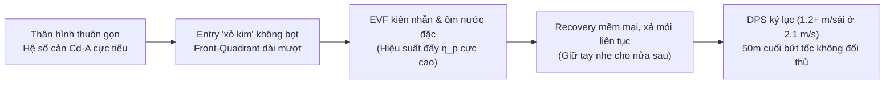

# Phân Tích VĐV Olympic: David Popovici — Đỉnh Cao Glide, DPS & Thân Nhẹ

> **Thuộc phần:** `athletes/` | **Cự ly sở trường:** 100m & 200m Freestyle | **Phong cách:** Hydrodynamic High-DPS Glide

## Tổng Quan (Overview)
Nếu Caeleb Dressel là hiện thân của sức mạnh cơ bắp bùng nổ, thì **David Popovici** (Romania — cao `1.90 m`, sải tay `2.05 m`, nhà vô địch Olympic 200m & cựu kỷ lục gia thế giới 100m `46.86s` ở tuổi 17) lại là **hiện thân hoàn hảo nhất của triết lý cuốn sách này: Bơi Tốc Độ Đỉnh Cao Với Đôi Tay Nhẹ Như Lông Hồng!** Với thân hình mảnh khảnh so với các đối thủ cùng đường đua, Popovici chinh phục thế giới nhờ **hệ số lực cản cực thấp, độ nổi cao tự nhiên, sải tay dài kỷ lục (DPS) và nhịp Front-Quadrant siêu mượt**.

- **Mục tiêu cốt lõi:** Giải mã cách Popovici đạt tốc độ `~2.13 m/s` với thân hình gọn nhẹ: **Tư thế đầu–ngực nổi cao thuôn dài**, **Front-Quadrant rộng thoáng**, **EVF cực kỳ kiên nhẫn** và **cổ tay–bàn tay thả lỏng tuyệt đối**.
- **Bài học cho người bơi `< 1:30/100m`:** Popovici là **hình mẫu dễ học và an toàn nhất** cho người bơi phong trào, Masters và Triathlete muốn bơi nhanh mà không cần thể hình vạm vỡ!
- **Đặc điểm nhận diện:** Dáng bơi thanh thoát, ít bọt trắng, nhịp tay gọn gàng (`~86–92 SPM` ở 100m, `~74–80 SPM` ở 200m) nhưng mỗi sải đi xa phi thường.

---

## Lý Thuyết (Theory)
Phong cách của Popovici chứng minh chân lý vật lý từ [Vật Lý Bơi](../01-foundation/physics-of-swimming.md): **Giảm $C_d \cdot A$ + Tối đa hóa Hiệu suất đẩy ($\eta_p$) đánh bại sức mạnh cơ bắp thuần túy**.
- Popovici không cố "đánh nhau" với nước bằng lực tay thô bạo; anh **lướt nằm trên bề mặt nước (*High Ride Height*)**, duy trì chiều dài thân tàu hiệu dụng $L$ tối đa nhờ sải tay `2.05 m` và nhịp Front-Quadrant cực sạch.
- Ngay cả ở tốc độ 100m kỷ lục thế giới, động tác rút tay (*Recovery*) của anh vẫn mang vẻ mềm mại, thanh thoát, giúp anh duy trì **tốc độ 50m cuối (Back-Half Speed) nhanh nhất thế giới**!

---

## Cơ Sở Khoa Học (Science)
### Vật Lý & Thủy Động Lực Học (Physics & Hydrodynamics)
- **Chỉ số Stroke Index ($\text{SI} = v \times \text{DPS}$) kỷ lục**: Ở chung kết `100m` (`46.86s`), Popovici chỉ dùng khoảng `~35–37 sải` cho `50m` đầu và `~38–40 sải` cho `50m` cuối (bể 50m!) — đạt **DPS thực tế lên tới `1.20–1.25 m/sải`** (`SL ≈ 2.45 m/chu kỳ`) ở vận tốc hơn `2.1 m/s`!
- **Giảm tối đa độ biến thiên vận tốc (IVV)**: Thay vì giật mạnh ở đầu pha kéo rồi hụt lực, Popovici giữ pha vào nước nhẹ như lông vũ, trượt gọn không bọt khí rồi **tăng tốc cực kỳ mượt mà xuyên suốt Pull–Push**, giữ dòng chảy tầng bám sát dọc thân người.

### Cơ Sinh Học (Biomechanics)
- **Điểm vào nước "Xa và Sạch" (*Clean Extended Entry*)**: Tay của Popovici vào nước thẳng trục trước vai, đầu ngón tay lướt ngọt không tạo bọt khí bọc quanh cẳng tay — tối ưu hóa 100% độ đặc của nước ngay lúc dựng EVF.
- **Độ linh hoạt khớp vai & cổ chân siêu hạng**: Khớp vai cực dẻo cho phép anh thực hiện **High-Elbow Recovery hơi mở tự nhiên** mà không hề tốn sức cơ delta; đôi bàn chân dẻo tạo nên cú 6-beat kick biên độ nhỏ, kín nước và cực kỳ êm.
- **Tư thế đầu độc đáo (Hơi cao nhẹ ở tốc độ > 2.0 m/s)**: Do vận tốc cực cao tạo lực nâng *Hydroplaning* lớn, đầu Popovici nổi cao hơn một chút so với người bơi phong trào nhưng **trục cột sống và hông vẫn phẳng tuyệt đối `< 3°`** nhờ Core khóa cứng và 6-beat kick đều. *(Lưu ý: Người bơi `< 1.30/100m` vẫn nên giữ đầu nhìn đáy `0–15°` vì chưa đạt ngưỡng Hydroplaning 2.0 m/s).*

---

## Thực Hành (Practical)
### Tại Sao Kỹ Thuật Này Hiệu Quả (Why It Works — Và Điều Bạn Nên Học)

Popovici là nguồn cảm hứng tuyệt vời nhất cho người Việt Nam và người bơi có thể hình mảnh/trung bình:
1. **Không cần gồng tay mới bơi nhanh**: Thả lỏng tuyệt đối pha Recovery và vào nước không bọt giúp bạn giữ sức cho 50% sau của cự ly (`Negative / Even Split`).
2. **Kiên nhẫn ở 0.1 giây đầu của pha Catch**: Đừng giật tay ngay khi vừa chạm nước — hãy ôm trọn khối nước sạch rồi mới tăng tốc kéo qua cơ xô.
3. **Tối ưu DPS trước, tăng SPM sau**: Xây nền DPS dài và êm ái ở `200m–400m` trước khi đẩy nhịp lên cho `100m`.

### Hướng Dẫn Từng Bước & Cảm Giác Nước (Step-by-Step & Water Cues)
1. **Học "Sự êm ái khi vào nước" của Popovici**: Tập *Silent Swimming* — mục tiêu không nghe thấy tiếng đập nước và không thấy chùm bọt trắng bám quanh cẳng tay khi bắt đầu EVF.
2. **Học "Tốc độ nửa sau" (*Back-Half Speed*)**: Trong các bài `100m` hoặc `200m`, giữ nửa đầu thật nhẹ tay, dài người, để bung hết lực đẩy EVF và 6-beat kick ở nửa sau.
3. **Học sự thả lỏng cổ tay**: Luôn kiểm tra xem bàn tay mình có đang mềm mại, mở khe ngón nhẹ `2–4 mm` trong cả pha Recovery lẫn pha kéo hay không.

<!-- IMAGE_PROMPT: Technical sports biomechanics analysis of David Popovici's 200m freestyle: underwater side view highlighting ultra-clean bubble-free hand entry, long Front-Quadrant extension maximizing hull length (L), patient high-elbow EVF catch, relaxed hand recovery, and whisper-quiet compact 6-beat kick. -->

### Mẹo Nâng Cao (Advanced Tips)
- **Bí mật "Động tác trông như đang bơi chậm"**: Khi xem Popovici bơi 200m (`1:42.97`), mắt thường có cảm giác anh đang bơi rất thong thả — đó chính là dấu hiệu của **Stroke Index ($\text{SI} = v \times \text{DPS}$) cực đại** và **0 năng lượng thừa** (không lắc hông, không vỗ sóng, không gồng vai).

---

## Bài Tập Thực Hành (Drills — Mô Phỏng Phong Cách Popovici)

| Tên Drill | Kỹ năng học từ Popovici | Cự ly / Số hiệp | Cảm giác đúng (Cue) |
| :--- | :--- | :--- | :--- |
| **Silent High-DPS Swim** | Tối thiểu hóa bọt khí & tối đa hóa DPS | `6 × 50m` (đếm sải + giữ mặt nước yên) | Cơ thể cắt nước êm ru như tàu ngầm, số sải giảm `2–3 sải/25m` |
| **Negative-Split 100s** | Học nghệ thuật giữ tay nhẹ 50m đầu, bứt tốc 50m sau | `4 × 100m` (nghỉ 25s, 50m sau nhanh hơn 50m đầu `1–2s`) | 50m đầu cảm giác 70% sức, 50m sau tăng lực EVF & nhịp chân vọt lên |
| **3/4 Catch-Up + Accelerating Push** | Kết hợp Front-Quadrant dài với pha đẩy sắc bén | `4 × 50m` (`25m Drill + 25m Swim`) | Thân dài liên tục, tăng tốc mượt về cuối mỗi sải |

---

## Phân Tích AI & Video (AI Analysis)
- **Thông số chuẩn mẫu của David Popovici (200m LCM):**
  - `SPM`: `74–82 SPM` | `DPS`: `1.28–1.35 m/sải` (SL `~2.60 m/chu kỳ`) | `IdC`: `-2% đến +2%` (Opposition chuẩn) | `Stroke Index`: `> 2.5 m²/s`.
- **Chỉ số đối chiếu cho người tập:** Theo dõi **độ suy giảm DPS giữa 50m đầu và 50m cuối** — mục tiêu giữ `DPS Drop-off < 5%` như Popovici.

---

## Lỗi Thường Gặp & Cách Sửa (Common Errors — Khi Bắt Chước Popovici)

| Lỗi thường gặp | Triệu chứng nhận biết | Nguyên nhân gốc | Cách sửa (Correction) |
| :--- | :--- | :--- | :--- |
| **Bắt chước tư thế đầu hơi cao của Popovici** | Chân chìm sâu, mỏi lưng dưới | Vận tốc người bơi phong trào (`1.1 m/s`) chưa đủ tạo lực nâng Hydroplaning như `2.1 m/s` | Giữ mắt nhìn thẳng đáy hồ (`0–15°`) để hông nổi tự nhiên |
| **Nhầm "bơi êm" thành "trượt quá chậm"** | SPM tụt xuống `< 52`, bị Dead Spot | Không thấy được gia tốc cực mạnh ở pha Mid-Pull và Push dưới nước của Popovici | Giữ tay nhẹ trên không nhưng **kéo dứt khoát và tăng tốc mạnh dưới nước** |
| **Bỏ qua nhịp chân vì thấy chân Popovici ít bọt** | Hông thiếu ổn định khi tăng tốc | Chân Popovici ít bọt là nhờ cổ chân siêu dẻo & biên độ gọn, không phải vì anh ngừng đạp chân | Tập giãn cổ chân và giữ nhịp chân gọn kín dưới mặt nước |

---

## Tự Đánh Giá Tại Hồ (Self Assessment)
- [ ] Tôi hiểu rõ vì sao Popovici đạt tốc độ thế giới dù thể hình mảnh: **Lực cản cực thấp + DPS cực dài + Recovery thả lỏng**.
- [ ] Tôi không bắt chước tư thế đầu cao của VĐV `2.1 m/s` khi bản thân đang bơi ở ngưỡng `1.1–1.3 m/s`.
- [ ] Tôi thực hành thành công bài **Negative-Split 100s** (50m sau nhanh hơn 50m đầu) nhờ giữ tay nhẹ ở nửa đầu.
- [ ] Pha vào nước của tôi sạch sẽ, hạn chế tối đa bọt khí bám vào cẳng tay trước khi dựng EVF.

---

## Chỉ Số Đo Lường (KPI — Tham Chiếu Popovici vs Mục Tiêu Phong Trào `< 1:30/100m`)

| Chỉ số (Metric) | Chuẩn David Popovici (200m) | Mục tiêu Phong trào (`< 1:30/100m`) |
| :--- | :---: | :---: |
| **Tỷ lệ DPS / Chiều cao ($H$)** | `~0.70–0.73` (mỗi sải đơn ở 2.0 m/s) | `0.82–0.95` (ở 1.15 m/s) |
| **Tempo (SPM) cự ly 200m** | `74–82 SPM` | `66–74 SPM` |
| **Chênh lệch 50m đầu vs 50m cuối (100m)** | `< 2.0 giây` (Back-half cực mạnh) | `< 2.5 giây` (Even/Negative Split) |

---

## Câu Hỏi Thường Gặp (FAQ)
**1. Người bơi phong trào muốn đạt `< 1:30/100m` nên học theo Dressel hay Popovici?**
**90% nên học theo mô hình David Popovici!** Phong cách của Popovici (giảm cản tối đa, Front-Quadrant mượt, EVF kiên nhẫn, Recovery thả lỏng, tối ưu DPS và Back-Half Speed) an toàn tuyệt đối cho khớp vai và phù hợp với mọi độ tuổi, thể trạng.

**2. Làm sao Popovici giữ được 50m cuối nhanh hơn tất cả đối thủ to khỏe hơn mình?**
Nhờ **tiết kiệm năng lượng cơ bắp ở 50% đầu** bằng kỹ thuật lướt sạch không bọt và thả lỏng pha Recovery, giúp lượng glycogen và độ tươi của sợi cơ còn dồi dào cho cú nước rút về đích.

---

## Tóm Tắt (Summary)
- **David Popovici** là hình mẫu hoàn hảo nhất của triết lý **Tốc độ cao – Tay nhẹ – Thân thuôn dài**.
- 3 chìa khóa học trực tiếp từ Popovici: **Vào nước không bọt + Ôm nước EVF kiên nhẫn + Thả lỏng tuyệt đối pha Recovery để giữ tốc độ nửa sau**.

**Liên kết chéo:**
- Chương trước: [Caeleb Dressel](caleb-dressel.md)
- Chương tiếp theo: [Katie Ledecky — Nhịp Gallop & Đường Dài Thống Trị](katie-ledecky.md)
- Kỹ thuật liên quan: [Distance Per Stroke (DPS)](../13-dps/distance-per-stroke.md) · [Giảm Lực Cản](../03-hydrodynamics/drag-reduction.md)
- Tra cứu thuật ngữ: [Glossary](../24-appendix/glossary.md)

---

## Tài Liệu Tham Khảo (References)
1. World Aquatics Biomechanics Reports — *Budapest 2022, Rome 2022 & Paris 2024 100m/200m Freestyle*.
2. SwimSmooth & Race Club Technical Analyses of David Popovici.
3. Maglischo, E. W. (2003). *Swimming Fastest*. Human Kinetics.

