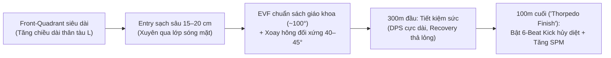

# Phân Tích VĐV Olympic: Ian Thorpe — Thủy Động Học, Chân Vịt Tự Nhiên & Nhịp Điệu Hoàn Hảo

> **Thuộc phần:** `athletes/` | **Cự ly sở trường:** 200m & 400m Freestyle | **Phong cách:** Classic Hydrodynamic Front-Quadrant & Powerful 6-Beat

## Tổng Quan (Overview)
**Ian Thorpe** (Australia — biệt danh *"The Thorpedo"*, cao `1.96 m`, cỡ giày EU 52 / US 17, 5 HCV Olympic) được giới khoa học bơi lội công nhận là một trong những VĐV sở hữu **kỹ thuật bơi sải đạt chuẩn sách giáo khoa thủy động lực học hoàn mỹ nhất lịch sử**. Dáng bơi của Thorpe kết hợp sự mềm mại, dài người của **Front-Quadrant** với một **động cơ 6-Beat Kick hủy diệt** và **EVF cực kỳ sâu, gọn**, tạo nên tốc độ lướt mượt mà đáng kinh ngạc trên cự ly `200m–400m`.

- **Mục tiêu cốt lõi:** Giải mã 3 di sản kỹ thuật bất hủ của Ian Thorpe: **Độ sâu tay trượt & EVF hoàn hảo**, **Kỹ thuật đạp chân 2 chiều (Downbeat + Upbeat)** và **Chiến thuật phân phối tốc độ Negative Split (tăng tốc ở 100m cuối)**.
- **Bài học cho người bơi `< 1:30/100m`:** Học cách **vào nước êm không bọt**, **khóa pha Front-Quadrant không vắt chéo** và **chuyển đổi từ 2-Beat/4-Beat sang 6-Beat bùng nổ ở đoạn kết**.
- **Đặc điểm nhận diện:** Bàn tay vào nước sâu hơn một chút để xuyên qua sóng mặt, cẳng tay dựng EVF chuẩn mực `100°`, và cú bứt tốc 100m cuối kinh điển (*Thorpedo Finish*).

---

## Lý Thuyết (Theory)
Kỹ thuật của Ian Thorpe được xây dựng trên triết lý của trường phái bơi Australia (HLV Doug Frost): **Tối đa hóa chiều dài sải tay (DPS) thông qua thân tàu siêu dài và động cơ chân bền bỉ**.
- Thorpe không bao giờ để hai cánh tay rơi vào trạng thái *Windmill*; anh luôn giữ **một tay trượt thẳng phía trước** tạo trục thân dài gần `2.5 m` (cộng thêm lợi thế cỡ bàn chân lớn giúp tăng chiều dài hiệu dụng $L$ và giảm Wave Drag!).
- Điểm độc đáo nhất trong pha kéo của Thorpe là **điểm vào nước sâu gọn (~15–20 cm)** rồi lập tức thiết lập **EVF sâu và rộng vừa bằng vai**, kéo một đường gần thẳng dọc dưới thân người với gia tốc tăng dần tới tận mép đùi.

---

## Cơ Sở Khoa Học (Science)
### Vật Lý & Thủy Động Lực Học (Physics & Hydrodynamics)
- **Tốc độ thân tàu (*Hull Speed*) tối đa**: Với chiều cao `1.96 m` + tay vươn dài Front-Quadrant, chiều dài hiệu dụng $L \approx 2.45\text{ m}$ giúp $v_{\text{hull}} \approx 1.25\sqrt{2.45} \approx 1.96\text{ m/s}$ — giải thích vì sao Thorpe lướt ở tốc độ `1.9 m/s` trong `400m` mà mặt nước quanh anh lại cực kỳ phẳng lặng!
- **Lợi thế "Chân vịt tự nhiên" (Size 17 + Plantar Flexion > 180°)**: Đôi bàn chân dài và cổ chân siêu dẻo của Thorpe giúp anh tạo ra lực đẩy từ 6-beat kick lớn hơn hẳn mặt bằng chung — nhưng yếu tố kỹ thuật thực sự tạo nên sức mạnh đó là **cú đá từ hông với biên độ gọn và pha kéo lên (*Upbeat*) cực khỏe**.

### Cơ Sinh Học (Biomechanics)
- **Chuỗi truyền lực đồng trục mẫu mực**: Góc xoay vai–hông của Thorpe đạt chuẩn **`40–45°`** cực kỳ đối xứng giữa hai bên trái và phải.
- **Pha Recovery mềm mại (High-Elbow Relaxed)**: Dù sở hữu đôi tay dài, Thorpe luôn gập khuỷu thả lỏng gọn gàng trên không — giữ nhịp tim thấp ở `300m` đầu tiên của cự ly `400m` để bung hết **6-Beat Kick** trong `100m` cuối!

---

## Thực Hành (Practical)
### Tại Sao Kỹ Thuật Này Hiệu Quả (Why It Works — Và Điều Bạn Nên Học)

Dù bạn không sở hữu chiều cao `1.96 m` hay bàn chân cỡ 17, **4 nguyên lý cốt lõi của Ian Thorpe** áp dụng chính xác cho mọi thể hình:
1. **Tôn trọng độ dài thân tàu**: Giữ tay trượt dài `10–15 cm` dưới mặt nước tạo đường lướt thẳng trước khi bắt đầu kéo.
2. **Đầu tư nghiêm túc vào độ dẻo cổ chân (*Plantar Flexion*)**: Không thể tăng chiều dài bàn chân, nhưng bạn có thể tăng góc duỗi cổ chân lên `170–180°` để đạt hiệu ứng chân vịt tự nhiên tương tự!
3. **Kéo gọn dọc trục vai (Chữ I mềm)**: Không vẽ chữ S rộng gây lắc hông — kéo chắc chắn thẳng về phía hông bằng cơ xô.
4. **Chiến thuật phân phối sức thông minh**: Bắt đầu điềm tĩnh bằng kỹ thuật hoàn hảo ở nửa đầu, chỉ bung hết 6-beat kick ở 25% cuối cùng.

### Hướng Dẫn Từng Bước & Cảm Giác Nước (Step-by-Step & Water Cues)
1. **Học điểm vào nước "Xuyên sóng"**: Đưa đầu ngón tay xuyên mượt xuống độ sâu `15 cm` trước vai, cảm nhận toàn bộ cánh tay lướt vào lớp nước tĩnh mát lạnh bên dưới bọt sóng bề mặt.
2. **Học pha EVF sâu và chắc**: Từ độ sâu `15 cm`, giữ khuỷu cao cố định, dựng cẳng tay vuông góc ôm trọn khối nước và kéo dọc sát trục vai xuống mép đùi.
3. **Học cú nước rút "Thorpedo Finish"**: Trong bài tập `4 × 100m` hoặc `200m`, giữ `75%` đầu bằng 2-beat/4-beat êm ái, rồi ở `25%` cuối bật 6-beat kick sắc gọn để chạm đích nhanh hơn nửa đầu!

<!-- IMAGE_PROMPT: Technical underwater side-view biomechanics analysis of Ian Thorpe's 400m freestyle: highlighting maximized hull length (L) with Front-Quadrant 15cm deep glide, textbook 100-degree EVF vertical forearm catch, symmetric 40-degree body roll, and hyper-flexible plantar-flexed 6-beat kick. -->

### Mẹo Nâng Cao (Advanced Tips)
- **Đừng trượt sâu quá 20 cm nếu bạn bơi chậm (`> 1:45/100m`)**: Thorpe vào nước sâu `~18–20 cm` hoạt động hoàn hảo ở vận tốc `1.9 m/s` nhờ sức mạnh cơ xô và 6-beat kick nâng vai. Với người bơi phong trào, giữ vùng ngọt **`10–15 cm`** là an toàn và dễ dựng EVF nhất.

---

## Bài Tập Thực Hành (Drills — Mô Phỏng Vũ Khí Của Ian Thorpe)

| Tên Drill | Kỹ năng học từ Ian Thorpe | Cự ly / Số hiệp | Cảm giác đúng (Cue) |
| :--- | :--- | :--- | :--- |
| **3/4 Catch-Up + Deep EVF** | Giữ chiều dài thân tàu tối đa & dựng cẳng tay `100°` | `4 × 50m` (nghỉ 20s) | Lướt dài êm ru, kéo chắc thẳng dọc trục vai |
| **Thorpedo Finish 100s** | Luyện chiến thuật giữ sức 75m đầu & bật 6-beat 25m cuối | `4 × 100m` (nghỉ 25s) | 75m đầu cực kỳ nhẹ tay, 25m cuối bật động cơ chân bứt tốc |
| **Short-Fin 6-Beat Endurance** | Mô phỏng lực đẩy bàn chân lớn & rèn pha Upbeat | `6 × 50m` (25m Streamline Kick + 25m 6-Beat Swim) | Cảm nhận đôi chân như chân vịt đẩy thân lướt băng băng |

---

## Phân Tích AI & Video (AI Analysis)
- **Thông số chuẩn mẫu của Ian Thorpe (400m LCM):**
  - `SPM`: `~68–74 SPM` (300m đầu) → `~80–84 SPM` (100m cuối) | `DPS`: `1.35–1.45 m/sải` (SL `~2.80 m/chu kỳ`) | `Góc EVF`: `~98–108°` | `Ankle Plantar Flexion`: `> 180°`.
- **Chỉ số đối chiếu cho người tập:** Kiểm tra độ đối xứng xoay vai–hông (`chênh lệch < 6°`) và góc gập gối trong 6-beat (`≥ 150°`).

---

## Lỗi Thường Gặp & Cách Sửa (Common Errors — Khi Bắt Chước Ian Thorpe)

| Lỗi thường gặp | Triệu chứng nhận biết | Nguyên nhân gốc | Cách sửa (Correction) |
| :--- | :--- | :--- | :--- |
| **Cắm tay quá sâu (> 30 cm) khi vào nước** | Vai chìm, mất đà, phải ấn nước xuống đáy | Hiểu nhầm độ sâu xuyên sóng `15–20 cm` thành cắm đầu ngón tay xuống đáy | San phẳng tay trượt ngay ở độ sâu `10–15 cm` song song mặt nước |
| **Cố dùng 6-Beat Kick từ mét đầu tiên của 400m** | Kiệt sức cơ đùi ở mét thứ 150 | Chưa có nền thể lực hiếu khí & độ dẻo cổ chân như VĐV Olympic | Dùng 2-beat/4-beat ở 75% đầu và chỉ bật 6-beat ở 25% cuối |
| **Trượt quá lâu để bắt chước DPS 2.8m** | Rơi vào Dead Spot, pace chậm | So sánh DPS tuyệt đối với VĐV cao `1.96 m` | Tối ưu DPS theo tỷ lệ chiều cao bản thân (`0.82–0.95 × H`) |

---

## Tự Đánh Giá Tại Hồ (Self Assessment)
- [ ] Tôi hiểu rõ cách Ian Thorpe tối đa hóa **Hull Speed** bằng thân tàu dài Front-Quadrant và giảm Wave Drag.
- [ ] Tôi đang cải thiện đều đặn độ dẻo cổ chân (*Plantar Flexion*) và sức mạnh pha kéo lên (*Upbeat*).
- [ ] Tôi áp dụng được chiến thuật **Thorpedo Finish** (nhẹ nhàng 75% đầu, bật 6-beat bứt tốc 25% cuối) trong bài tập `100m–400m`.
- [ ] Góc xoay vai–hông của tôi giữ đối xứng đều 2 bên (`35–45°`) như chuẩn mực của Thorpe.

---

## Chỉ Số Đo Lường (KPI — Tham Chiếu Ian Thorpe vs Mục Tiêu Phong Trào `< 1:30/100m`)

| Chỉ số (Metric) | Chuẩn Ian Thorpe (400m) | Mục tiêu Phong trào (`< 1:30/100m`) |
| :--- | :---: | :---: |
| **Góc khuỷu EVF dưới nước** | `98–108°` | `100–120°` |
| **Độ duỗi cổ chân Plantar Flexion** | `> 180°` | `165–180°` |
| **Tempo (SPM) cự ly 400m** | `70–76 SPM` (tăng lên `82` cuối) | `66–74 SPM` (tăng lên `78` cuối) |

---

## Câu Hỏi Thường Gặp (FAQ)
**1. Kỹ thuật của Ian Thorpe (đầu thập niên 2000) đến nay có còn phù hợp không?**
Hoàn toàn phù hợp và vẫn được giảng dạy tại USA Swimming & Swimming Australia! Nền tảng của Thorpe — **Streamline dài, EVF sâu, xoay thân đối xứng, Recovery thả lỏng và phân phối nhịp chân thông minh** — là những quy luật vật lý bất biến của bơi sải.

**2. Làm sao tập được cú bứt tốc 100m cuối (Thorpedo Finish) mà không bị đuối?**
Bí mật nằm ở việc **kỷ luật bơi đủ nhẹ ở 300m đầu** (không để nhịp tim vọt qua ngưỡng Zone 3 quá sớm) kết hợp tập đều bài `Thorpedo Finish 100s` mỗi tuần!

---

## Tóm Tắt (Summary)
- **Ian Thorpe** là chuẩn mực sách giáo khoa về **Thủy động lực học thân dài (Hull Speed)**, **EVF sâu `100°`**, **độ dẻo cổ chân** và **chiến thuật tăng tốc cuối chặng (*Negative Split*)**.
- Áp dụng trực tiếp: Giữ độ sâu trượt sạch `10–15 cm`, tối ưu độ dẻo cổ chân và luyện chuyển số từ 2/4-beat sang 6-beat ở 25% cuối.

**Liên kết chéo:**
- Chương trước: [Katie Ledecky](katie-ledecky.md)
- Chương tiếp theo: [Sun Yang — Nghệ Thuật Chuyển Nhịp 2 → 6-Beat](sun-yang.md)
- Kỹ thuật liên quan: [Độ Dẻo Cổ Chân](../08-kicking/ankle-mobility.md) · [High Elbow Catch (EVF)](../09-catch/early-vertical-forearm.md)
- Tra cứu thuật ngữ: [Glossary](../24-appendix/glossary.md)

---

## Tài Liệu Tham Khảo (References)
1. Maglischo, E. W. (2003). *Swimming Fastest*. Human Kinetics.
2. Swimming Australia — *Ian Thorpe Biomechanical Case Study (200m & 400m Freestyle)*.
3. Newsome, P., & Young, A. (2012). *Swim Smooth*. Wiley.

