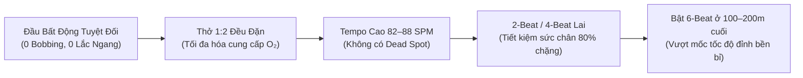

# Phân Tích VĐV Olympic: Katie Ledecky — Nhịp Gallop, 2-Beat Lai & Thống Trị Đường Dài

> **Thuộc phần:** `athletes/` | **Cự ly sở trường:** 400m, 800m & 1500m Freestyle | **Phong cách:** High-Tempo Hip-Driven Gallop

## Tổng Quan (Overview)
**Katie Ledecky** (Hoa Kỳ — cao `1.83 m`, 9 HCV Olympic, giữ kỷ lục thế giới 800m & 1500m với khoảng cách bỏ xa phần còn lại hàng chục giây) là nữ VĐV bơi sải đường dài vĩ đại nhất mọi thời đại. Điểm gây kinh ngạc nhất trong kỹ thuật của Ledecky là **cô phá vỡ khuôn mẫu cũ "bơi đường dài phải quạt chậm rãi"**: cô duy trì một **nhịp tay cực kỳ sắc bén (`82–88 SPM`)**, kết hợp **nhịp Gallop (bất đối xứng có kiểm soát)** và **2-Beat / 4-Beat Kick lai** để biến cơ thể thành một chiếc tàu tốc hành không bao giờ hụt hơi.

- **Mục tiêu cốt lõi:** Giải mã bí mật tốc độ đường dài của Ledecky: **Đầu bất động tuyệt đối**, **Tempo cao không Dead Spot**, **Nhịp thở 1:2 cung cấp tối đa oxy** và **Khả năng bật 6-Beat ở 100m cuối**.
- **Bài học cho người bơi `< 1:30/100m` & Triathlete:** Đừng bơi đường dài quá chậm nhịp (`SPM < 55`); ưu tiên **thở 1:2 đủ oxy**, **đầu ổn định** và **2-beat kick sắc gọn**.
- **Đặc điểm nhận diện:** Tay phải vào nước sâu và đẩy mạnh đồng bộ nhịp thở, đầu như gắn trên giá đỡ chống rung (nổi tiếng với thử thách bơi đội cốc sữa sô-cô-la trên đầu không đổ!).

---

## Lý Thuyết (Theory)
Kỹ thuật **Gallop Freestyle** (*Loping / Hybrid Stroke*) của Katie Ledecky hoạt động dựa trên sự **phối hợp nhịp bất đối xứng có chủ đích**:
- Ledecky thở **nhịp 1:2** (mỗi 2 sải thở 1 lần về bên phải) trong suốt 1.500m để nạp lượng oxy tối đa cho hệ hiếu khí.
- Ở **sải bên thở (bên phải)**: Tay trái trượt dài phía trước thêm một phần nhỏ của giây, tay phải thực hiện pha kéo cực mạnh kết hợp cú xoay hông sâu (`~45°`) và cú đạp chân dứt khoát tạo đà phóng cơ thể tới trước.
- Ở **sải bên không thở (bên trái)**: Nhịp tay chuyển nhanh gọn hơn không trượt lâu, giữ cho tần suất tổng **SPM luôn ở mức cao (`82–88 SPM`)** và loại bỏ hoàn toàn điểm chết tốc độ!

---

## Cơ Sở Khoa Học (Science)
### Vật Lý & Thủy Động Lực Học (Physics & Hydrodynamics)
- **Triệt tiêu dao động đầu (Thử thách cốc sữa trên đầu)**: Trong video nổi tiếng năm 2020, Ledecky bơi hết 1 chiều bể với một cốc sữa đầy đặt trên đỉnh đầu mà không rơi một giọt! Về mặt thủy động học, điều này chứng minh **độ dao động dọc (Bobbing) và độ lắc ngang của đầu cô gần bằng `0 cm`** — giúp sóng mũi (*Bow Wave*) và dòng chảy dọc thân ổn định tuyệt đối.
- **Chiến lược Tiết Kiệm Oxy Bằng 2-Beat/4-Beat Lai**: Trong 1.200m đầu của cự ly 1.500m, Ledecky chủ yếu dùng **2-Beat Kick** (hoặc 4-Beat `3+1` nhẹ), giữ mức tiêu thụ oxy của đôi chân ở mức tối thiểu để dồn toàn bộ lưu lượng máu giàu oxy nuôi cơ xô và hệ tim mạch.

### Cơ Sinh Học (Biomechanics)
- **Tốc độ bắt nước cực sớm (*Early Catch*)**: Ledecky gần như không có giai đoạn chờ thụ động dài ở tay không thở; ngay khi tay chạm nước, cổ tay và cẳng tay lập tức gài góc EVF bám vào nước tĩnh.
- **Độ bền cơ lõi (Core Endurance)**: Nhịp Gallop có lực xoay lớn sang một bên đòi hỏi nhóm cơ chéo bụng (*Obliques*) cực khỏe để giữ cột sống thẳng tắp suốt 15 phút đua 1.500m mà không bị vẫy đuôi (*Fishtailing*).

---

## Thực Hành (Practical)
### Tại Sao Kỹ Thuật Này Hiệu Quả (Why It Works — Và Điều Bạn Nên Học)

Kỹ thuật của Ledecky là **mỏ vàng cho người bơi phong trào, Triathlete và Open Water**:
1. **Dũng cảm dùng nhịp thở 1:2 khi bơi tốc độ cao**: Nếu bạn cứ ép mình thở 1:3 khi bơi bài `400m–1.500m` ở ngưỡng `< 1:30/100m`, bạn đang tự cắt giảm `33%` lượng oxy nạp vào! Hãy học Ledecky thở **1:2** (hoặc **2:2 đổi bên theo chiều bể** để giữ cân bằng vai).
2. **Giữ đầu ổn định tuyệt đối**: Tập trung giữ đỉnh đầu yên lặng giữa hai vai đang xoay — chỉ riêng điều này đã giúp bạn tiết kiệm hàng chục nhịp tim mỗi phút.
3. **Duy trì Tempo sắc bén ở cự ly dài**: Đừng để nhịp tay rơi xuống `< 58 SPM` ở nửa sau chặng đua; dùng Tempo Trainer giữ nhịp ổn định `68–76 SPM`.

### Hướng Dẫn Từng Bước & Cảm Giác Nước (Step-by-Step & Water Cues)
1. **Tập giữ đầu ổn định như Ledecky**: Bơi với **Center Snorkel**, nhìn chằm chằm vào đường gạch đen đáy hồ; tưởng tượng có một ly nước đầy đặt trên đỉnh đầu bạn — không để đầu nhấp nhô lên xuống hay lắc trái phải.
2. **Áp dụng chiến lược "2-Beat 80% + 6-Beat 20%"**: Trong các bài `400m` hoặc `1.000m`, giữ 2-beat kick cực êm cho 80% cự ly đầu, rồi bật 6-beat kick mạnh mẽ ở 20% cuối để bứt phá thành tích!
3. **Thở gọn không phá nhịp**: Khi thở 1:2, giữ 1 mắt kính chạm nước và đưa mặt về đáy cực nhanh để không làm chậm nhịp SPM.

<!-- IMAGE_PROMPT: Technical sports biomechanics diagram of Katie Ledecky's 1500m freestyle: side view highlighting rock-steady motionless head (zero vertical bobbing), crisp 1:2 breathing in the bow wave pocket, high-tempo 85 SPM early catch, and energy-saving 2-beat/4-beat hybrid kick. -->

### Mẹo Nâng Cao (Advanced Tips)
- **Cảnh báo về nhịp Gallop cho người mới**: Đừng cố tình bắt chước độ lệch nhịp Gallop của Ledecky nếu bạn chưa bơi ổn định `< 1:25/100m` với nhịp đối xứng hoàn hảo — tập Gallop quá sớm rất dễ biến thành lỗi mất cân bằng vai và vắt chéo tay! Hãy học **sự ổn định đầu, nhịp thở 1:2, Tempo cao và chiến lược 2-beat** của cô.

---

## Bài Tập Thực Hành (Drills — Mô Phỏng Vũ Khí Của Ledecky)

| Tên Drill | Kỹ năng học từ Ledecky | Cự ly / Số hiệp | Cảm giác đúng (Cue) |
| :--- | :--- | :--- | :--- |
| **Still-Head Snorkel Swim** | Khóa đầu bất động 0 cm dao động dọc & ngang | `4 × 50m` (nghỉ 15s) | Vạch đen đáy hồ đứng im trong tầm mắt, chỉ vai và hông xoay quanh trục |
| **1:2 Breathing Tempo Hold** | Tối ưu cung cấp oxy & giữ SPM ổn định suốt cự ly dài | `4 × 200m` @ CSS (đổi bên thở mỗi 50m) | Hơi thở dồi dào, nhịp tim ổn định, không bị hụt nhịp ở 50m cuối |
| **80/20 Kick Gear-Shift** | Bơi 2-beat tiết kiệm sức rồi bật 6-beat về đích | `3 × 200m` (150m 2-beat + 50m 6-beat) | Đôi chân hoàn toàn tươi mới để bùng nổ ở 50m cuối |

---

## Phân Tích AI & Video (AI Analysis)
- **Thông số chuẩn mẫu của Katie Ledecky (800m–1500m LCM):**
  - `SPM`: `82–88 SPM` | `Breathing`: `1:2` liên tục | `Head Vertical Bobbing`: `< 2 cm` | `Kick`: 2-Beat / 4-Beat lai (`3+1`), chuyển 6-Beat ở 100m cuối.
- **Chỉ số đối chiếu cho người tập:** Đo biên độ dao động dọc của điểm `forehead/nose` (`< 4 cm`) và độ ổn định `SPM` trong bài `400m` (`Tempo Drift < 4%`).

---

## Lỗi Thường Gặp & Cách Sửa (Common Errors — Khi Bắt Chước Ledecky)

| Lỗi thường gặp | Triệu chứng nhận biết | Nguyên nhân gốc | Cách sửa (Correction) |
| :--- | :--- | :--- | :--- |
| **Cố tình bơi lệch nhịp Gallop sớm** | Tay bên không thở vắt chéo, hông lắc mạnh, đau vai | Chưa có nền Core và kỹ thuật đối xứng vững | Giữ nhịp đối xứng 2 bên, đổi bên thở theo chiều bể (2:2) |
| **Thở 1:2 nhưng ngẩng đầu quá cao** | Chìm hông liên tục mỗi 2 sải | Lạm dụng tần suất thở mà chưa sửa kỹ thuật One-Goggle | Hoàn thiện [Breathing Mechanics](../07-breathing/breathing-mechanics.md) trước khi đẩy nhịp 1:2 |
| **Quạt 85 SPM khi chưa có EVF chắc** | Trượt nước, Stroke Count tăng vọt | Ép theo SPM của Ledecky mà vượt quá trần kỹ thuật bản thân | Dùng Ramp Test chọn đúng Điểm Ngọt SPM cá nhân (`66–76 SPM`) |

---

## Tự Đánh Giá Tại Hồ (Self Assessment)
- [ ] Đầu tôi giữ ổn định gần như tuyệt đối (không nhấp nhô lên xuống) trong các bài bơi dài.
- [ ] Tôi biết tận dụng nhịp thở **1:2** (hoặc **2:2 đổi bên**) ở tốc độ ngưỡng CSS để không bao giờ bị thiếu oxy.
- [ ] Tôi thực hiện được chiến thuật **2-Beat 80% + 6-Beat 20%** trong các bài bơi `200m–400m`.
- [ ] Tôi duy trì được nhịp tay (SPM) đều đặn từ đầu đến cuối cự ly dài mà không bị đuối nhịp.

---

## Chỉ Số Đo Lường (KPI — Tham Chiếu Ledecky vs Mục Tiêu Phong Trào `< 1:30/100m`)

| Chỉ số (Metric) | Chuẩn Katie Ledecky (1500m) | Mục tiêu Phong trào (`< 1:30/100m`) |
| :--- | :---: | :---: |
| **Dao động dọc của đỉnh đầu (Bobbing)** | `< 2 cm` | `< 5 cm` |
| **Nhịp thở ở cự ly 400m–1500m** | `1:2` (mỗi chu kỳ) | `1:2` hoặc `2:2` đổi bên |
| **Tempo (SPM) đường dài** | `82–88 SPM` | `66–76 SPM` |
| **Chênh lệch 100m đầu vs 100m cuối (400m)** | `< 1.0 giây` | `< 2.5 giây` |

---

## Câu Hỏi Thường Gặp (FAQ)
**1. Tại sao Ledecky bơi 1500m lại dùng nhịp tay (85 SPM) nhanh hơn nhiều VĐV nam?**
Vì sải tay nữ ngắn hơn nam (nên DPS tự nhiên ngắn hơn một chút), Ledecky bù đắp bằng **nhịp tay cao, cực kỳ sắc gọn không Dead Spot** cùng khả năng cung cấp oxy siêu việt từ nhịp thở 1:2 và 2-beat kick. Đây cũng là công thức vàng cho mọi người bơi có chiều cao trung bình (`1.58–1.72 m`)!

**2. Triathlete nên học gì nhiều nhất từ Katie Ledecky?**
**Thở 1:2 đủ oxy + Đầu bất động + 2-Beat Kick tiết kiệm chân + Nhịp tay ổn định xuyên sóng** — 4 vũ khí hoàn hảo cho cả bể bơi lẫn Open Water 1.9km / 3.8km!

---

## Tóm Tắt (Summary)
- **Katie Ledecky** chứng minh sức mạnh của **Đầu bất động tuyệt đối**, **Tempo sắc gọn không Dead Spot**, **nhịp thở 1:2 dồi dào oxy** và **chiến lược 2-Beat/4-Beat tiết kiệm năng lượng** cho cự ly dài.
- Giữ nhịp đối xứng 2 bên (đổi bên thở `2:2`) để hưởng trọn lợi ích của mô hình Ledecky mà vẫn bảo vệ khớp vai tuyệt đối.

**Liên kết chéo:**
- Chương trước: [David Popovici](david-popovici.md)
- Chương tiếp theo: [Ian Thorpe — Thủy Động Học & Nhịp Điệu Hoàn Hảo](ian-thorpe.md)
- Kỹ thuật liên quan: [2-Beat Kick](../08-kicking/two-beat-kick.md) · [Kỹ Thuật Thở](../07-breathing/breathing-mechanics.md)
- Tra cứu thuật ngữ: [Glossary](../24-appendix/glossary.md)

---

## Tài Liệu Tham Khảo (References)
1. World Aquatics Race Analysis — *Katie Ledecky 800m & 1500m World Record Splits*.
2. Newsome, P., & Young, A. (2012). *Swim Smooth*. Wiley.
3. USA Swimming — *Distance Freestyle Pacing & Breathing Mechanics*.

