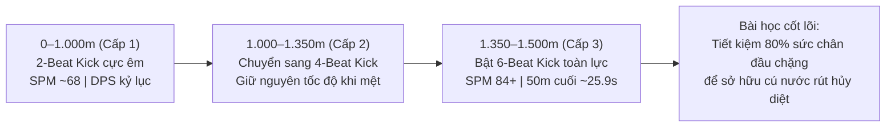

# Phân Tích VĐV Olympic: Sun Yang — Nghệ Thuật Chuyển Nhịp 2 → 6-Beat & Bơi Đường Dài

> **Thuộc phần:** `athletes/` | **Cự ly sở trường:** 400m, 800m & 1500m Freestyle | **Phong cách:** Long-Lever Hybrid 2→6-Beat Distance

## Tổng Quan (Overview)
**Sun Yang** (Trung Quốc — cao `1.98 m`, sải tay `2.11 m`, chủ nhân kỷ lục thế giới 1500m `14:31.02` kéo dài hơn một thập kỷ tại Olympic London 2012) là bậc thầy vĩ đại về **tối đa hóa chiều dài sải tay (DPS) ở cự ly đường dài** và **nghệ thuật chuyển hộp số nhịp chân từ 2-Beat sang 6-Beat** để tạo ra cú nước rút `50m` cuối cùng không tưởng (`25.9 giây` ngay ở cuối chặng `1.500m`!).

- **Mục tiêu cốt lõi:** Giải mã cách Sun Yang kết hợp **thả lỏng cực đại bằng 2-Beat Kick** trong 1.300m đầu, **tầm vươn sải tay khổng lồ với DPS kỷ lục**, và **cơ chế chuyển số sang 6-Beat Kick bùng nổ** mà không vỡ form EVF.
- **Bài học cho người bơi `< 1:30/100m`:** Học kỷ luật **tiết kiệm năng lượng cực đại bằng 2-beat**, **xoay hông sâu tạo tầm với tối đa** và **khả năng giữ Stroke Count cố định suốt cự ly dài**.
- **Đặc điểm nhận diện:** Sải tay cực dài và thong thả (`~66–70 SPM` ở 1500m), chân gần như im lìm 2-beat trong suốt phần lớn chặng đua rồi đột ngột "bật công tắc" 6-beat cuộn sóng ở 100m cuối.

---

## Lý Thuyết (Theory)
Kỹ thuật của Sun Yang là hình mẫu lý tưởng cho **chiến lược Quản Trị Năng Lượng Đường Dài (*Distance Energy Budgeting*)**:
- Với sải tay `2.11 m`, Sun Yang sử dụng một kiểu phối hợp **Front-Quadrant rộng và thả lỏng** (`IdC` khoảng `-5% đến 0%`), cho phép anh đi hết `50m` bể dài chỉ trong **`~30–32 sải`** (`DPS ≈ 1.45–1.55 m/sải` — `SL ≈ 3.0 m/chu kỳ`!) ở tốc độ `58 giây/100m`!
- Anh áp dụng chiến thuật **"Hộp số 3 cấp" (*3-Gear Kick Strategy*)**:
  - *Cấp 1 (0–1.000m)*: **2-Beat Kick** cực nhẹ, giữ nhịp tim trong vùng hiếu khí bền vững.
  - *Cấp 2 (1.000–1.350m)*: Chuyển sang **4-Beat Kick (3+1)** để giữ vững tốc độ khi cơ xô bắt đầu tích tụ mệt mỏi.
  - *Cấp 3 (1.350–1.500m)*: Bật toàn lực **6-Beat Kick** + tăng SPM lên `84+` để bứt tốc như một VĐV Sprint 100m!

---

## Cơ Sở Khoa Học (Science)
### Vật Lý & Thủy Động Lực Học (Physics & Hydrodynamics)
- **Chỉ số Hiệu suất Kỷ Lục ($\text{SI} = v \times \text{DPS}$)**: Ở tốc độ trung bình `1.72 m/s` suốt 1.500m, Sun Yang duy trì **$\text{SI} \approx 2.55–2.65\text{ m}^2/\text{s}$** — một trong những chỉ số hiệu suất thủy động học cao nhất từng được ghi nhận trong lịch sử bơi lội nam!
- **Giảm thiểu lực cản sóng nhờ nhịp 2-Beat êm**: Khi bơi 2-beat với hai chân khép gọn phía sau, luồng nước phía sau thân người của Sun Yang gần như phẳng lì, giảm thiểu thất thoát năng lượng thành sóng bề mặt.

### Cơ Sinh Học (Biomechanics)
- **Pha Recovery lai mở rộng (*Wide Relaxed Semi-Straight Recovery*)**: Giống nhiều VĐV có độ linh hoạt vai cực tốt, Sun Yang vung tay hơi mở thoáng trên không ở tốc độ đều để giảm căng cứng khớp vai trong suốt 15 phút bơi liên tục — nhưng **dưới nước luôn giữ EVF sâu và đẩy trọn vẹn qua hông**.
- **Xoay hông sâu (`40–45°`) dẫn động tầm với**: Mọi centimet tầm với phía trước đều đến từ độ xoay trơn tru của khung sườn và hông, giúp hai vai luôn ở trạng thái thả lỏng.

---

## Thực Hành (Practical)
### Tại Sao Kỹ Thuật Này Hiệu Quả (Why It Works — Và Điều Bạn Nên Học)

Rất nhiều người bơi phong trào thất bại khi thử thách bản thân ở cự ly `400m–1.500m` vì **họ bơi 100m đầu như một VĐV Sprint 6-beat** rồi kiệt sức lết về đích. Mô hình Sun Yang dạy bạn:
1. **Sự kiên nhẫn là vũ khí tốc độ**: Giữ nhịp 2-beat êm ái, tập trung giữ **Stroke Count thấp ổn định** trong 75% đầu chặng.
2. **Làm chủ kỹ năng chuyển số `2 → 4 → 6-beat`**: Không đợi đến lúc mệt mới đổi nhịp một cách bị động — hãy tập luyện việc chủ động bật 4-beat và 6-beat theo mốc cự ly.
3. **Giữ tay nhẹ nhờ vươn bằng xoay hông**: Cảm nhận vai luôn thoáng mở, không gồng cứng cơ thang trên khi bơi đường dài.

### Hướng Dẫn Từng Bước & Cảm Giác Nước (Step-by-Step & Water Cues)
1. **Khởi đầu điềm tĩnh ở Cấp 1**: Trong `100m–200m` đầu tiên của bài bơi dài, khóa chặt nhịp **2-beat kick**, giữ số sải tay thấp nhất có thể ở tốc độ mục tiêu.
2. **Giữ DPS không rơi khi chuyển số**: Khi bật lên 4-beat ở đoạn giữa và 6-beat ở đoạn cuối, **tuyệt đối không cắt ngắn pha Push** — dùng sức chân để giữ hông nổi cao và đẩy thân đi nhanh hơn trên cùng một sải tay dài!
3. **Thở đều đặn 1:2 (hoặc 2:2 đổi bên)**: Đảm bảo nguồn oxy liên tục dồi dào cho cơ thể trước khi bật Cấp 3 nước rút.

<!-- IMAGE_PROMPT: Technical sports biomechanics progression graphic of Sun Yang's 1500m freestyle strategy: 3 horizontal lanes showing Gear 1 (2-beat quiet kick, ultra-long DPS 68 SPM), Gear 2 (4-beat transitional rhythm), and Gear 3 (explosive 6-beat sprint kick 84 SPM final 100m), with clean underwater EVF and body-roll highlights. -->

### Mẹo Nâng Cao (Advanced Tips)
- **Áp dụng cho cự ly `400m` Test CSS**:
  - `100m #1`: 2-Beat êm, thả lỏng, cảm giác 75% sức.
  - `100m #2 & #3`: Chuyển 4-Beat, giữ pace đều tăm tắp (Even Split).
  - `100m #4`: Bật 6-Beat + tăng nhẹ SPM `3–5 nhịp` để bứt phá về đích (`Negative Split`)!

---

## Bài Tập Thực Hành (Drills — Mô Phỏng Vũ Khí Của Sun Yang)

| Tên Drill | Kỹ năng học từ Sun Yang | Cự ly / Số hiệp | Cảm giác đúng (Cue) |
| :--- | :--- | :--- | :--- |
| **3-Gear Distance Progression** | Chuyển số chân chủ động `2 → 4 → 6-beat` trên cự ly dài | `3 × 150m` (`50m 2-beat + 50m 4-beat + 50m 6-beat`) | Tốc độ tăng dần đều mỗi 50m trong khi tay giữ nguyên độ dài DPS |
| **Stroke-Count Lock 200s** | Giữ DPS không sụp đổ khi mệt mỏi đường dài | `3 × 200m` @ CSS (nghỉ 25s) | Số sải/25m ở 50m cuối bằng đúng 50m đầu (`± 1 sải`) |
| **Fast-Finish 400m** | Mô phỏng cú nước rút 50m cuối của Sun Yang | `1 × 400m` (300m Z2/Z3 2-beat + 100m Z4 6-beat) | Đôi chân vẫn tươi mới bùng nổ ở 100m cuối |

---

## Phân Tích AI & Video (AI Analysis)
- **Thông số chuẩn mẫu của Sun Yang (1500m WR):**
  - `SPM`: `66–70 SPM` (1.300m đầu) → `84+ SPM` (100m cuối) | `DPS`: `1.45–1.55 m/sải` | `Stroke Index`: `~2.60 m²/s` | `Kick`: `2-Beat → 4-Beat → 6-Beat`.
- **Chỉ số đối chiếu cho người tập:** Kiểm tra độ mượt của chuyển pha `2 → 4 → 6-beat` (không làm tăng đột biến `Stroke Count` hay phá góc EVF).

---

## Lỗi Thường Gặp & Cách Sửa (Common Errors — Khi Bắt Chước Sun Yang)

| Lỗi thường gặp | Triệu chứng nhận biết | Nguyên nhân gốc | Cách sửa (Correction) |
| :--- | :--- | :--- | :--- |
| **Bắt chước Recovery mở rộng thẳng tay khi vai cứng** | Đau mỏi mặt ngoài khớp vai sau 500m | Thiếu độ mở khớp vai tự nhiên của VĐV cao 1m98 | Duy trì **High-Elbow Relaxed Recovery** gọn sát sườn |
| **Chờ quá muộn mới chuyển số (hết sức tay rồi)** | Đến 100m cuối chân vẫn tươi nhưng tay sụp khuỷu không kéo nổi | Kéo quá nặng bằng tay ở 300m đầu hoặc thiếu oxy | Thở đủ 1:2 và chuyển lên 4-beat sớm hơn ở 2/3 chặng |
| **Bật 6-beat làm vỡ hoàn toàn nhịp tay** | Vừa tăng nhịp chân là tay quạt vội loạn xạ | Chưa tách biệt được điều khiển nhịp chân và tay | Tập thường xuyên bài `Kick Gear-Shift (2 → 4 → 6)` |

---

## Tự Đánh Giá Tại Hồ (Self Assessment)
- [ ] Tôi hiểu rõ cách phân bổ 3 cấp nhịp chân (`2 → 4 → 6-beat`) cho cự ly `400m–1.500m`.
- [ ] Tôi có thể giữ số sải tay (Stroke Count) ổn định suốt bài bơi `3 × 200m` mà không bị vỡ form ở 50m cuối.
- [ ] Khi bật 6-beat kick ở 50m cuối cùng, đôi chân tôi vẫn đủ tươi mới để tạo cú bứt tốc rõ rệt.
- [ ] Tôi luôn khởi đầu các bài bơi dài một cách điềm tĩnh, ưu tiên DPS và cảm giác tay nhẹ trước.

---

## Chỉ Số Đo Lường (KPI — Tham Chiếu Sun Yang vs Mục Tiêu Phong Trào `< 1:30/100m`)

| Chỉ số (Metric) | Chuẩn Sun Yang (1500m) | Mục tiêu Phong trào (`< 1:30/100m`) |
| :--- | :---: | :---: |
| **Chiến lược nhịp chân** | `2-Beat → 4-Beat → 6-Beat` | `2-Beat (75%) → 4/6-Beat (25%)` |
| **Độ suy giảm Stroke Count cuối 400m** | `< 3%` | `< 6%` (`≤ +1 sải/25m`) |
| **Tốc độ 50m cuối so với trung bình chặng** | Nhanh hơn `~3 giây` | Nhanh hơn `1–2 giây` (*Fast Finish*) |

---

## Câu Hỏi Thường Gặp (FAQ)
**1. Trong 5 huyền thoại (Dressel, Popovici, Ledecky, Thorpe, Sun Yang), tôi nên học theo ai nhất?**
Hãy kết hợp tinh hoa của tất cả theo mục tiêu cá nhân của bạn:
- Muốn **dáng bơi nhẹ, đẹp, tốc độ `< 1:30/100m`**: Học **David Popovici** & **Ian Thorpe**.
- Muốn **bơi đường dài / Triathlon bền bỉ**: Học **Katie Ledecky** (đầu tĩnh, thở 1:2) & **Sun Yang** (chuyển số `2 → 6-beat`).
- Muốn **bứt tốc 50m–100m & xuất phát/lộn vòng sắc bén**: Học **Caeleb Dressel** (UDK & Breakout).

**2. Tại sao Sun Yang có thể bơi 50m cuối của 1500m nhanh gần bằng VĐV bơi 100m?**
Nhờ **độ tiết kiệm năng lượng tuyệt đối trong 1.400m đầu** (2-beat kick, DPS kỷ lục, nhịp tim kiểm soát sát ngưỡng hiếu khí), giúp dự trữ glycogen và hệ thần kinh ở chân vẫn còn nguyên vẹn cho cú bật 6-beat cuối cùng!

---

## Tóm Tắt (Summary)
- **Sun Yang** là bậc thầy về **DPS đường dài siêu hạng** và **chiến thuật hộp số chân 3 cấp (`2-Beat → 4-Beat → 6-Beat`)**.
- Học từ Sun Yang: Điềm tĩnh giữ DPS và 2-beat kick trong 75% đầu chặng để sở hữu một cú nước rút **Fast Finish** mạnh mẽ ở đoạn kết.

**Liên kết chéo:**
- Chương trước: [Ian Thorpe](ian-thorpe.md)
- Chương tiếp theo: [Kỹ Thuật Bơi Nước Mở (Open Water)](../15-open-water/open-water-skills.md)
- Kỹ thuật liên quan: [2-Beat Kick](../08-kicking/two-beat-kick.md) · [4-Beat Kick](../08-kicking/four-beat-kick.md)
- Tra cứu thuật ngữ: [Glossary](../24-appendix/glossary.md)

---

## Tài Liệu Tham Khảo (References)
1. World Aquatics Race Analysis — *London 2012 1500m Freestyle World Record Split & Stroke Data*.
2. Newsome, P., & Young, A. (2012). *Swim Smooth*. Wiley.
3. Maglischo, E. W. (2003). *Swimming Fastest*. Human Kinetics.

