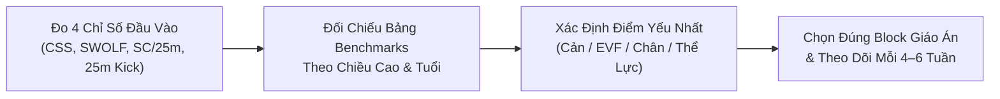

# Bảng Chuẩn Hiệu Suất Bơi Sải (*Performance Benchmarks*)

> **Thuộc phần:** `benchmarks/` | **Phạm vi:** Bể 25m (SCM) & Bể 50m (LCM) | **Đơn vị:** Phút:Giây / 100m

## Tổng Quan (Overview)
Để đặt mục tiêu tập luyện khoa học và đánh giá đúng vị trí hiện tại của bản thân, bạn cần một **hệ thống bảng chuẩn định lượng (Benchmarks)** phân chia theo **trình độ, giới tính, nhóm tuổi (Masters) và chiều cao cơ thể**. Tài liệu này tổng hợp đầy đủ các chuẩn tham chiếu thực tế cho **Pace 100m, Pace CSS, SWOLF, Stroke Count, DPS, Tempo (SPM) và Dryland**.

---

## 1. Bảng Chuẩn Tổng Quát Theo Trình Độ (Bể 25m — Nam / Nữ Trưởng Thành 18–39 Tuổi)

| Cấp độ | 100m Hết Sức (Nam / Nữ) | Pace CSS (Nam / Nữ) | 1.500m (Nam / Nữ) | SWOLF (25m, cao ~1m70) | Tỷ lệ DPS / Chiều cao |
| :--- | :---: | :---: | :---: | :---: | :---: |
| **Người mới (Beginner)** | `> 2:00` / `> 2:15` | `> 2:10` / `> 2:25` | `> 35:00` / `> 38:00` | `50 – 62` | `0.55 – 0.65` |
| **Phong trào (Recreational)** | `1:40–1:59` / `1:50–2:14` | `1:48–2:09` / `1:58–2:24` | `28:00–34:59` / `31:00–37:59` | `42 – 49` | `0.68 – 0.78` |
| **Trung cấp Mạnh (Fit Club)** | `1:28–1:39` / `1:35–1:49` | `1:34–1:47` / `1:42–1:57` | `24:00–27:59` / `26:30–30:59` | `36 – 41` | `0.80 – 0.88` |
| **Nâng cao (`< 1:30` Bền Vững)** | **`1:15–1:27` / `1:22–1:34`** | **`1:20–1:33` / `1:27–1:41`** | **`20:30–23:59` / `22:30–26:29`** | **`32 – 36`** | **`0.88 – 0.98`** |
| **Bán chuyên / Elite Masters** | `< 1:05` / `< 1:12` | `< 1:12` / `< 1:18` | `< 18:30` / `< 20:00` | `27 – 32` | `0.98 – 1.12` |

*(Lưu ý quy đổi bể 50m LCM: Cộng thêm khoảng `+2.0 đến +3.0 giây/100m` so với bể 25m SCM do ít hơn 2 lần đạp tường Flip Turn mỗi 100m).*

---

## 2. Hệ Số Điều Chỉnh Chuẩn Theo Độ Tuổi (*Masters Age-Group Adjustment*)

Sinh lý tim mạch và sức mạnh cơ bắp thay đổi tự nhiên theo độ tuổi, nhưng **hiệu suất kỹ thuật (DPS, SWOLF, EVF) vẫn có thể đạt mức xuất sắc ở mọi lứa tuổi**:

| Nhóm tuổi (Masters) | Hệ số điều chỉnh Pace CSS so với nhóm 25–34 tuổi | Mục tiêu 100m Hết Sức Xuất Sắc (Nam / Nữ) |
| :---: | :---: | :---: |
| **18 – 34 tuổi** | `Chuẩn gốc (0s)` | `< 1:20` / `< 1:28` |
| **35 – 44 tuổi** | `+2 đến +4 giây/100m` | `< 1:25` / `< 1:33` |
| **45 – 54 tuổi** | `+5 đến +8 giây/100m` | `< 1:30` / `< 1:38` |
| **55 – 64 tuổi** | `+9 đến +14 giây/100m` | `< 1:36` / `< 1:45` |
| **65+ tuổi** | `+15 đến +22 giây/100m` | `< 1:45` / `< 1:55` |

---

## 3. Bảng Chuẩn Stroke Count & Tempo (SPM) Theo Chiều Cao (Ở Tốc Độ `< 1:30/100m`, Bể 25m)

| Chiều cao cơ thể ($H$) | Sải tay ước tính | Stroke Count mục tiêu / 25m | DPS thực tế (`20m / SC`) | Tempo (SPM) khuyến nghị |
| :---: | :---: | :---: | :---: | :---: |
| **`1.55 – 1.64 m`** | `~1.58–1.66 m` | `17 – 20 sải` | `1.05 – 1.25 m/sải` | `72 – 82 SPM` |
| **`1.65 – 1.74 m`** | `~1.68–1.77 m` | `15 – 18 sải` | `1.20 – 1.42 m/sải` | `68 – 76 SPM` |
| **`1.75 – 1.84 m`** | `~1.78–1.88 m` | `13 – 16 sải` | `1.35 – 1.60 m/sải` | `64 – 72 SPM` |
| **`1.85 m+`** | `≥ 1.90 m` | `11 – 14 sải` | `1.50 – 1.85 m/sải` | `60 – 68 SPM` |

---

## 4. Chuẩn Kỹ Thuật & Thể Lực Bổ Trợ Để Phá Mốc `< 1:30/100m`

| Hạng mục kiểm tra | Ngưỡng Tối Thiểu Cần Đạt | Ngưỡng Tối Ưu |
| :--- | :---: | :---: |
| **Trượt Streamline không đạp chân** | `≥ 6.5 m` | `≥ 8.5 m` |
| **25m Streamline Kick trần (không ván, không fins)** | `≤ 28 giây` | `≤ 22 giây` |
| **25m Front/Mid Sculling (Pull Buoy, không chân)** | `≤ 38 giây` | `≤ 28 giây` |
| **Thời gian Turn (`5m-In / 5m-Out`)** | `≤ 7.5 giây` | `≤ 6.5 giây` |
| **Hollow Body Streamline Hold (Dryland)** | `≥ 35 giây` | `≥ 60 giây` |
| **Pull-Up chuẩn form (Nam / Nữ)** | `≥ 6` / `≥ 2` | `≥ 12` / `≥ 6` |
| **Seated Heel-Sit (Độ dẻo cổ chân)** | Hở `≤ 2 cm` | `0 cm` áp phẳng hoàn toàn |

---

## Tóm Tắt & Tài Liệu Tham Khảo (Summary & References)
- Luôn so sánh **Stroke Count, DPS và SWOLF** theo đúng **chiều cao cơ thể và chiều dài bể**, không so sánh máy móc với người có thể hình khác biệt.
- **Liên kết chéo:** [SWOLF & CSS](../14-stroke-count/swolf-and-energy-systems.md) · [Tổng Quan Giáo Án 24 Tuần](../22-training-plan/overview-and-css-testing.md) · [Glossary](../24-appendix/glossary.md)
- **Nguồn tham khảo:** World Aquatics Masters Standards, USA Swimming Motivational Times, SwimSmooth Benchmarks.

