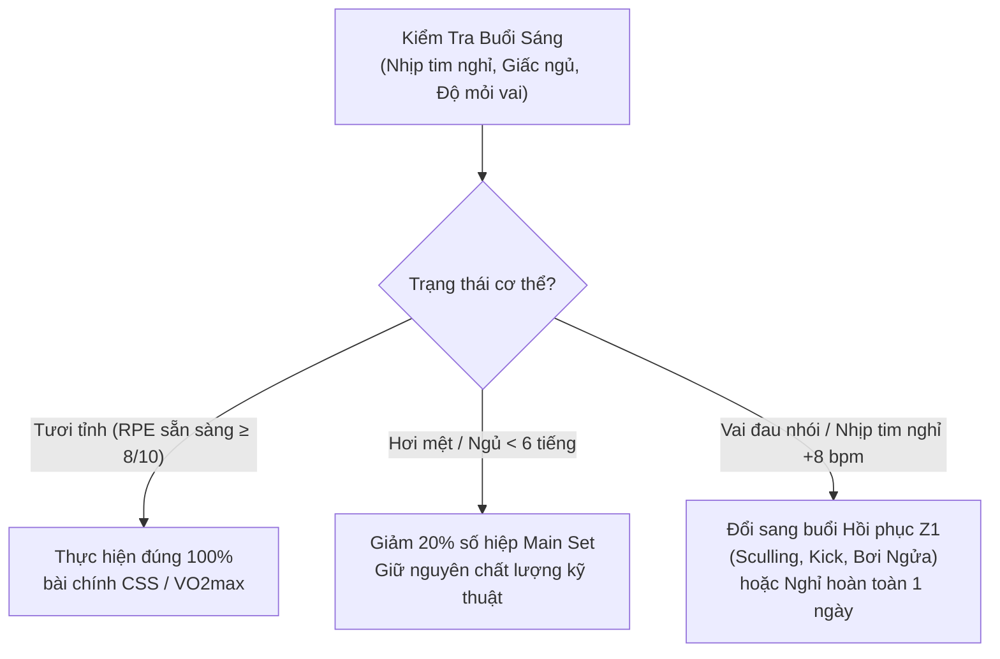

# Ghi Chú Thực Chiến Của Huấn Luyện Viên (*Coach Field Notes*)

> **Thuộc phần:** `coach-notes/` | **Mục đích:** Kinh nghiệm sửa lỗi nhanh tại hồ, tâm lý vận động & cá nhân hóa giáo án

## Tổng Quan (Overview)
Sách giáo khoa dạy bạn nguyên lý hoàn hảo trong điều kiện lý tưởng, nhưng **kinh nghiệm thực chiến trên bờ hồ** mới giúp bạn xử lý những tình huống "ngoài sách vở": học viên biết rõ lý thuyết EVF nhưng xuống nước vẫn sụp khuỷu, người bơi bị chững tốc độ suốt 3 tháng ở `1:38/100m`, hay người bơi Masters bị đau vai mỗi khi tăng khối lượng. Tập hợp ghi chú dưới đây đúc kết những bài học thực tế đắt giá nhất của các HLV bơi sải hiện đại.

---

## 1. Quy Tắc "Sửa 1 Lỗi Gốc — Rụng 3 Lỗi Ngọn"

Trong thực tế huấn luyện, **80% lỗi nhìn thấy ở cánh tay và bàn chân thực chất là phản ứng tự vệ của não bộ trước một lỗi ở Đầu hoặc Hơi thở**:

| Triệu chứng dễ thấy (Lỗi Ngọn) | Nguyên nhân thật thường bị bỏ qua (Lỗi Gốc) | Mẹo sửa cực nhanh trong 1 buổi |
| :--- | :--- | :--- |
| **Hai chân đá cắt kéo (Scissor Kick)** | Xoay đầu quá cao khi thở + Tay vào nước vắt chéo | Sửa One-Goggle Breathing + đường ray 11h/1h → Scissor Kick tự biến mất 80% |
| **Hông chìm sâu dù đạp chân rất mạnh** | Ngẩng đầu nhìn trước + Nín hơi căng phổi quá mức | Hạ mắt nhìn đáy + Thở bọt liên tục (`Humming Exhale`) → Hông tự nổi ngay lập tức |
| **Sụp khuỷu EVF ở bên trái** | Chỉ thở bên phải → Tay trái ấn xuống đáy để chống đầu lên thở | Tập Side-Glide + Single-Arm giữ tay trái trên "mặt bàn nước `15 cm`" |
| **Mỏi rã cơ vai sau 400m** | Bơi thân phẳng (`< 15°`) không xoay hông + Gồng tay pha Recovery | Tập 6-Kick Switch + Fingertip Drag → Vai lập tức nhẹ bẫng |

---

## 2. Xử Lý 5 Tình Huống "Kẹt Ngưỡng" Phổ Biến Nhất

### Tình huống A: Kẹt mãi ở `1:45 – 1:55/100m` (Dáng đẹp nhưng không nhanh lên được)
- **Chẩn đoán:** 90% rơi vào bẫy **Over-Gliding** (`SPM < 56`) hoặc **bơi quá nhiều Junk Miles Z2** mà không có buổi ngưỡng CSS.
- **Đơn thuốc HLV:** Đeo **Tempo Trainer** đẩy nhẹ nhịp tay từ `56 → 68 SPM` trong 4 tuần (bằng cách rút gọn pha trượt từ `0.35s → 0.15s`), kết hợp `10 × 100m @ CSS (r:15s)` mỗi tuần 1 lần.

### Tình huống B: Kẹt mãi ở `1:33 – 1:37/100m` (Không phá nổi `< 1:30/100m`)
- **Chẩn đoán:** Thường mất **`3–5 giây/100m` miễn phí** ở 3 chi tiết nhỏ: (1) Vẫn quay đầu chạm tay (Open Turn), (2) Lấy hơi ở sải đầu sau Breakout và 10m cuối, (3) Cắt cụt 20% cuối pha Push ngang hông.
- **Đơn thuốc HLV:** Dành 3 tuần học chắc **Flip Turn + 3 Dolphin Kick vượt vạch 6m** + **Thumb-to-Thigh** + **Taper 10 ngày** → Phá mốc `1:29` gần như chắc chắn!

### Tình huống C: Người tập Chạy bộ / Đạp xe (Triathlete) chuyển sang bơi
- **Đặc thù cơ thể:** Cơ đùi đặc và nặng (chìm chân), cổ chân rất cứng (`110–130°`), hay có phản xạ đạp chân quá mạnh gây hụt hơi.
- **Đơn thuốc HLV:** Không bao giờ ép tập 6-Beat Kick dài! Chuyển ngay sang **2-Beat Kick + Seated Heel-Sit giãn cổ chân 10p/ngày + Press the T + Front-Quadrant** để tận dụng nền tim mạch sẵn có cực mạnh của họ.

### Tình huống D: Bị đau nhói mặt trước vai (*Early Swimmer's Shoulder*)
- **Đơn thuốc khẩn cấp:**
  1. Dừng ngay mọi loại **Hand Paddles** và **bơi bướm/bơi sải tốc độ tối đa** trong 7–10 ngày.
  2. Kiểm tra video góc chính diện xem có bị **Thumb-First Entry** hoặc **Crossover** không.
  3. Tăng cường **bơi ngửa thả lỏng** (mở ngực), **Face Pull + External Rotation** và **mở cột sống ngực (T-Spine)**.
  4. Nếu đau vẫn kéo dài `> 2 tuần` khi sinh hoạt thường ngày → đi khám bác sĩ y học thể thao ngay, không cố tập xuyên qua cơn đau!

### Tình huống E: Chỉ có đúng `30–40 phút` mỗi buổi tập (Dân văn phòng siêu bận)
- **Công thức buổi tập "Tối Ưu Hóa 35 Phút" (`1.400–1.600m`):**
  - `5p` Khởi động cạn trên bờ (Band EVF + xoay vai).
  - `300m` Warm-up + Sculling (`6p`).
  - `1.000–1.200m` **Main Set chất lượng cao** (ví dụ `10 × 100m @ CSS r:15s`, `20p`).
  - `100–200m` Cool-down (`4p`).
  - *Ghi nhớ:* **3 buổi × 35 phút đúng ngưỡng CSS hiệu quả gấp 3 lần 3 buổi × 60 phút bơi tà tà không mục tiêu!**

---

## 3. Nghệ Thuật Cá Nhân Hóa Giáo Án Theo Tín Hiệu Cơ Thể

---

## 4. Bộ Câu Nhắc Thần Chú 3 Chữ Tại Hồ (*Pocket Cues*)

Khi mệt ở 200m cuối, não bộ không đọc nổi cả đoạn văn lý thuyết. Hãy chọn đúng **1 câu nhắc 3 chữ** lặp lại theo nhịp tay cho từng buổi tập:
- *Tư thế:* **"Đầu nhìn đáy"** · **"Ấn nhẹ ngực"** · **"Thu nhẹ rốn"**
- *Tay nhẹ:* **"Xỏ kim êm"** · **"Vươn qua thùng"** · **"Quẹt túi quần"** · **"Rũ cổ tay"**
- *Thở & Xoay:* **"Thổi bọt đều"** · **"Một mắt kính"** · **"Bật xoay hông"**

---

## Tóm Tắt & Tài Liệu Tham Khảo (Summary & References)
- Luôn xử lý **Lỗi Gốc (Đầu/Thở → Tư thế → Xoay/Entry)** trước khi chỉnh sửa chi tiết ngọn ở pha kéo.
- Linh hoạt điều chỉnh tải tập theo tín hiệu phục hồi (giấc ngủ, độ mỏi vai, nhịp tim nghỉ) để duy trì chuỗi tập luyện 24 tuần không gián đoạn.
- **Liên kết chéo:** [Coach Evaluation](../23-checklists/coach-evaluation.md) · [Self Evaluation](../23-checklists/self-evaluation.md) · [Glossary](../24-appendix/glossary.md)

