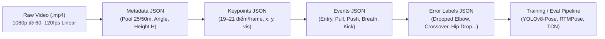

# Schema Dữ Liệu Video & Gán Nhãn Cho AI Phân Tích Bơi Sải (*Dataset Schema*)

> **Thuộc phần:** `datasets/` | **Trình độ:** Trung cấp → Nâng cao | **Thời gian đọc:** ~10 phút

## Tổng Quan (Overview)
Để huấn luyện hoặc đánh giá bất kỳ mô hình AI phân tích bơi sải nào (Pose Estimation, Stroke Phase Segmentation, Error Classification), **cấu trúc dữ liệu chuẩn hóa (*Dataset Schema*)** là yếu tố sống còn. Tài liệu này định nghĩa chuẩn JSON/COCO mở rộng dành riêng cho bộ dữ liệu video bơi sải (`SwimPose-VN / Freestyle-Dataset`), đảm bảo tính nhất quán giữa người quay, HLV gắn nhãn và kỹ sư AI.

- **Mục tiêu cốt lõi:** Chuẩn hóa cấu trúc thư mục video, định dạng file metadata JSON, 19 điểm khớp mở rộng (*COCO-17 + 2 Toe/Finger Tips*), nhãn pha động tác và nhãn lỗi kỹ thuật.
- **Cảm giác đúng:** Mọi đoạn video quay tại hồ đều có thể đưa ngay vào hệ thống gán nhãn và huấn luyện AI mà không cần xử lý lại cấu trúc.
- **Sai lầm phổ biến nhất:** Lưu video lẫn lộn không ghi rõ góc quay, chiều dài bể, tốc độ khung hình (fps) hoặc gán nhãn lỗi cảm tính không có mốc khung hình cụ thể.

---

## Lý Thuyết (Theory)
Một mẫu dữ liệu chuẩn (*Sample Unit*) cho bài toán AI phân tích bơi sải gồm **3 thành phần đồng bộ**:
1. **Raw Video Clip**: Đoạn video `10–30 giây` (`1080p @ 60–120fps Linear FOV`) của 1 chiều bể `25m` hoặc `50m`.
2. **Metadata & Calibration JSON**: Thông tin VĐV (chiều cao $H$ để chuẩn hóa DPS), chiều dài bể, góc camera, tỷ lệ quy đổi `pixels_per_meter` và `waterline_y`.
3. **Frame-Level & Event-Level Annotations**: Tọa độ `(x, y, visibility)` của 19 keypoints theo khung hình + danh sách mốc thời gian pha tay (`Entry, Pull, Push, Recovery`), nhịp chân (`2/4/6-beat`) và nhãn lỗi kỹ thuật.

---

## Cơ Sở Khoa Học (Science)
### Vật Lý & Thủy Động Lực Học (Physics & Hydrodynamics)
- **Chuẩn hóa bất biến tỷ lệ (*Scale-Invariant Normalization*)**: Mọi tọa độ khớp thô `(x, y)` phải được chuẩn hóa theo **chiều dài thân trên (`shoulder → hip`)** hoặc **chiều cao cơ thể $H$** để mô hình AI không bị sai lệch giữa người cao `1.60 m` và `1.90 m`, hoặc giữa khoảng cách camera `2.5 m` và `4.0 m`.
- **Trạng thái hiển thị điểm khớp (`visibility`)**:
  - `0`: Không có trong khung hình (*Out of Frame*).
  - `1`: Bị che khuất bởi bọt khí hoặc thân người (*Occluded — ước lượng*).
  - `2`: Hiển thị rõ nét 100% (*Visible*).

### Cơ Sinh Học (Biomechanics) — Bộ 19 Keypoints Mở Rộng (COCO-17 + 2 Điểm Đỉnh Thủy Động)

So với chuẩn COCO-17 thông thường, bơi sải **bắt buộc bổ sung 2 điểm mút** (hoặc 4 điểm trái–phải): `left/right_middle_finger_tip` (để đo góc cổ tay & điểm vào nước) và `left/right_toe_tip` (để đo chính xác góc duỗi cổ chân *Plantar Flexion*!).



---

## Thực Hành (Practical)
### Tại Sao Kỹ Thuật Này Hiệu Quả (Why It Works)
Cấu trúc JSON gọn nhẹ, tách rõ `metadata`, `frames` và `events` giúp bạn dễ dàng nhập xuất trực tiếp với **CVAT**, **Label Studio**, **Kinovea XML** và các framework **PyTorch / MMPose / Ultralytics**.

### Hướng Dẫn Từng Bước (Step-by-Step) — Chuẩn JSON Mẫu (`sample_annotation.json`)

```json
{
  "dataset_version": "swim-book-v1.0",
  "clip_id": "20261125_swimmer01_sideUW_CSS",
  "metadata": {
    "swimmer_height_cm": 174,
    "pool_length_m": 25,
    "camera_angle": "underwater_side",
    "fps": 60,
    "resolution": [1920, 1080],
    "fov_mode": "linear",
    "waterline_y_px": 240,
    "pixels_per_meter": 285.0,
    "pace_100m_sec": 88.5,
    "kick_type": "4-beat"
  },
  "events": [
    {"type": "hand_entry_R", "frame": 112, "time_s": 1.867},
    {"type": "evf_catch_peak_R", "frame": 134, "time_s": 2.233, "elbow_angle_deg": 112.4},
    {"type": "push_release_R", "frame": 168, "time_s": 2.800},
    {"type": "breath_peak_R", "frame": 162, "time_s": 2.700, "one_goggle_ok": true}
  ],
  "error_labels": [
    {"error_code": "ERR_NONE", "severity": 0, "notes": "Clean EVF and flat alignment"}
  ]
}
```

### Quy Ước Mã Lỗi Chuẩn Hóa (`error_code`)

| Mã lỗi (`error_code`) | Tên lỗi | Tầng ưu tiên | File hướng dẫn sửa |
| :--- | :--- | :---: | :--- |
| `ERR_HEAD_UP` | Ngẩng đầu nhìn trước (`> 20°`) | Tầng 1 | [Body Position](../04-body-position/body-position-and-alignment.md) |
| `ERR_LATE_BREATH` | Thở muộn (`t_head_return > t_entry`) | Tầng 1 | [Breathing Mechanics](../07-breathing/breathing-mechanics.md) |
| `ERR_HIP_DROP` | Chìm hông (`θ_body > 10°`) | Tầng 2 | [COG & COB](../01-foundation/center-of-gravity-and-buoyancy.md) |
| `ERR_SCISSOR_KICK` | Đá cắt kéo khi thở (`mở gối > 35 cm`) | Tầng 2 | [Drag Reduction](../03-hydrodynamics/drag-reduction.md) |
| `ERR_CROSSOVER` | Tay vắt chéo trục giữa | Tầng 3 | [Hand Entry](../09-catch/hand-entry-and-extension.md) |
| `ERR_DROPPED_ELBOW` | Sụp khuỷu (`EVF > 145°`) | Tầng 4 | [EVF Catch](../09-catch/early-vertical-forearm.md) |
| `ERR_SHORT_FINISH` | Cắt cụt pha Push trước hông | Tầng 4 | [Pull & Push](../10-pull/pull-and-push-phase.md) |
| `ERR_OVER_GLIDE` | Trượt chết tốc độ (`IdC < -18%`) | Tầng 4 | [Rhythm & Timing](../12-rhythm/rhythm-and-timing.md) |


<!-- IMAGE_PROMPT: Clean software architecture & sports data diagram showing pool video clips entering a structured folder tree (raw_videos/, annotations_json/, calibrated_keypoints/) with a visual callout of the 21-keypoint underwater swimmer skeleton and JSON event schema. -->

### Mẹo Nâng Cao (Advanced Tips)
- **Chia tập dữ liệu theo ID Người Bơi (*Subject-Disjoint Split*)**: Khi chia `Train / Val / Test (70/15/15)`, **tuyệt đối không để video của cùng 1 người bơi xuất hiện ở cả tập Train lẫn tập Test** (tránh *Data Leakage* làm độ chính xác ảo).

---

## Bài Tập Thực Hành (Drills — Quy Trình Thu Thập Dữ Liệu Sạch Tại Hồ)

| Bước thu thập | Yêu cầu chuẩn | Số lượng tối thiểu cho 1 bộ mini-dataset |
| :--- | :--- | :--- |
| **Ghi hình đa trình độ** | Quay cả người mới (`> 2:00`), trung cấp (`1:45`) và nâng cao (`< 1:30`) | Tối thiểu `20–30` người bơi khác nhau |
| **Gán nhãn 2 lớp (Double-Check)** | 1 HLV gán nhãn `events + error_labels`, 1 người kiểm định chéo | Độ đồng thuận (*Cohen's Kappa*) `≥ 0.85` |

---

## Phân Tích AI & Video (AI Analysis)
- **Định dạng lưu trữ khuyến nghị:** Lưu danh sách khung hình nặng dưới dạng `.parquet` hoặc `.npz` (NumPy compressed) khi tập dữ liệu vượt `100.000` khung hình để tăng tốc độ đọc gấp `10×` so với JSON thuần.

---

## Lỗi Thường Gặp & Cách Sửa (Common Errors)
| Lỗi thường gặp | Triệu chứng nhận biết | Nguyên nhân gốc | Cách sửa (Correction) |
| :--- | :--- | :--- | :--- |
| **Thiếu trường `swimmer_height_cm` & `pixels_per_meter`** | Không tính được DPS và vận tốc thực (m/s) | Quên đo mốc chuẩn khi thu thập video | Bắt buộc điền đầy đủ block `metadata` trước khi lưu kho |
| **Lẫn lộn nhãn `Left` và `Right` khi người bơi đổi chiều bể** | AI huấn luyện bị đảo tay trái–phải | Không chú ý hướng bơi (`left_to_right` vs `right_to_left`) | Thêm trường `swim_direction` trong metadata và kiểm tra kỹ khi gán nhãn |

---

## Tự Đánh Giá Tại Hồ (Self Assessment)
- [ ] Tôi hiểu rõ cấu trúc 3 tầng của một mẫu dữ liệu bơi AI (`Video + Metadata + Annotations`).
- [ ] Tôi nắm được danh sách 8 mã lỗi chuẩn hóa (`ERR_HEAD_UP` → `ERR_OVER_GLIDE`) và ánh xạ trực tiếp sang tài liệu sửa lỗi.
- [ ] Tôi biết quy tắc chia tập dữ liệu theo ID người bơi (*Subject-Disjoint Split*) để tránh rò rỉ dữ liệu.

---

## Chỉ Số Đo Lường (KPI)
| Chỉ số chất lượng Dataset | Ngưỡng đạt chuẩn |
| :--- | :---: |
| **Độ đồng thuận gán nhãn giữa 2 HLV (*Inter-Rater Kappa*)** | `≥ 0.85` |
| **Tỷ lệ khung hình bị lỗi/thiếu metadata** | `0%` |
| **Độ cân bằng lớp lỗi (Class Balance)** | Mỗi mã lỗi có tối thiểu `50+` chu kỳ mẫu |

---

## Câu Hỏi Thường Gặp (FAQ)
**1. Có bộ dữ liệu bơi lội mã nguồn mở nào có thể dùng thử nghiệm ngay không?**
Bạn có thể tham khảo **SwimmerNET / FineGym / SportsMOT** hoặc bộ dữ liệu nghiên cứu của **Zecha & Lienhart (University of Augsburg)** về *Underwater Swimmer Pose Estimation* để pre-train mô hình trước khi fine-tune bằng video tự quay theo schema này.

**2. Có cần gán nhãn thủ công từng khung hình một ở `60 fps` không?**
Không! Chỉ cần gán nhãn các khung hình chốt (*Keyframes*, khoảng mỗi `5–10 frames`) trên **CVAT** rồi dùng tính năng **Auto-Interpolation + Model-Assisted Labeling** để tiết kiệm `80%` thời gian!

---

## Tóm Tắt (Summary)
- **Dataset Schema** chuẩn hóa toàn bộ vòng đời dữ liệu bơi AI từ `Raw Video` → `Metadata hiệu chuẩn` → `19–21 Keypoints` → `Events & 8 Mã lỗi chuẩn`.
- Là nền tảng kết nối trực tiếp kho tri thức kỹ thuật `swim-book` với các hệ thống Computer Vision hiện đại.

**Liên kết chéo:**
- Chương trước: [Quy Trình Quay Đa Góc & Video Annotation](../21-video-analysis/filming-and-annotation-workflow.md)
- Chương tiếp theo: [Danh Mục Video Tham Khảo](../videos/reference-video-catalog.md)
- Tra cứu thuật ngữ: [Glossary](../24-appendix/glossary.md)

---

## Tài Liệu Tham Khảo (References)
1. Lin, T. Y., et al. (2014). *Microsoft COCO: Common Objects in Context*. ECCV.
2. Zecha, D., Einfalt, M., Eggert, C., & Lienhart, R. (2018). *Kinematic Pose Rectification for Performance Analysis and Retrieval in Sports*. IEEE CVPR Workshops.
3. CVAT Open-Source Annotation Platform Documentation.

