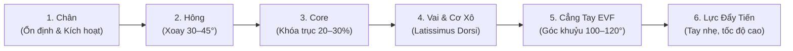
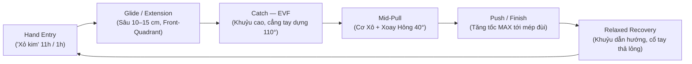
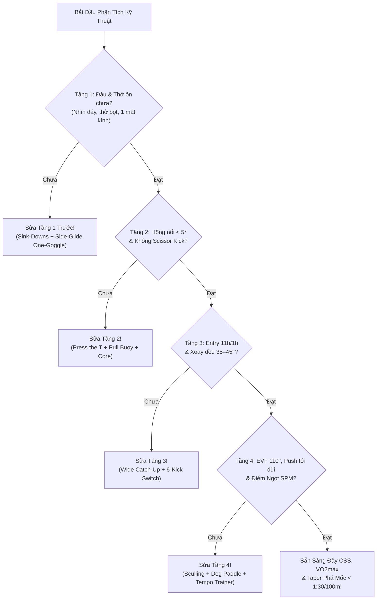
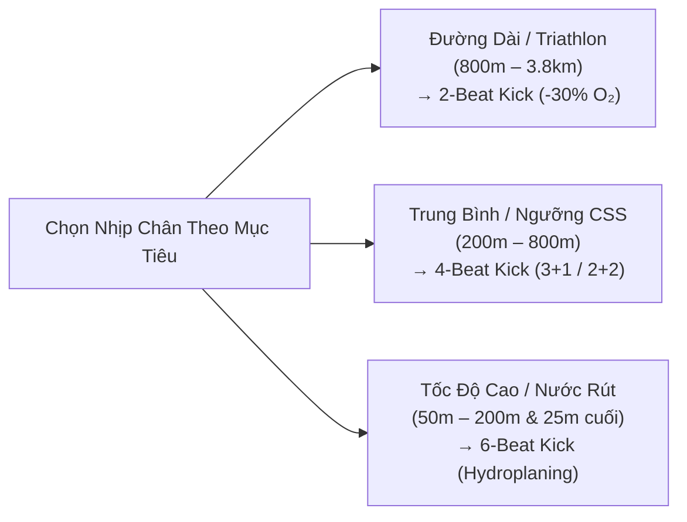
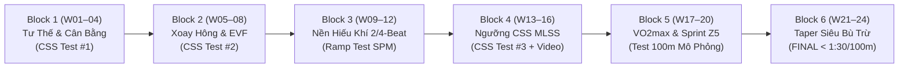
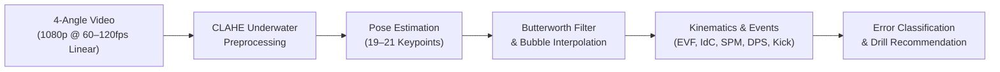

# Thư Viện Sơ Đồ Mermaid Chuẩn Hóa (`mermaid/diagrams-library.md`)

> **Thuộc phần:** `mermaid/` | **Mục đích:** Kho tập trung các sơ đồ luồng chuyển động, chuỗi truyền lực, cây quyết định sửa lỗi và kiến trúc giáo án có thể tái sử dụng trực tiếp trên GitHub, Obsidian, GitBook, MkDocs và Hugo.

---

## 1. Chuỗi Truyền Lực Cốt Lõi (*Master Kinetic Chain*)

---

## 2. Chu Kỳ Sải Tay Đầy Đủ (*Full Freestyle Stroke Cycle*)

---

## 3. Cây Quyết Định Chẩn Đoán & Sửa Lỗi 4 Tầng (*Root-Cause Diagnostic Tree*)

---

## 4. Ma Trận Chọn Nhịp Chân Theo Cự Ly (*Kick Gear-Shift Matrix*)

---

## 5. Kiến Trúc Giáo Án 24 Tuần (`< 1:30/100m` Roadmap)

---

## 6. Pipeline Phân Tích Bơi Sải Bằng AI (*Computer Vision Architecture*)

---

*Quay lại: [SUMMARY.md](../SUMMARY.md) · [README.md](../README.md)*

