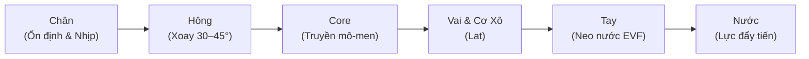

# Kỹ Năng Bơi Sải Nâng Cao (`skill.md`)

> **Bản tóm tắt thực chiến (Quick Reference)** — Dùng để ôn nhanh trước khi xuống hồ hoặc làm ngữ cảnh ngắn gọn cho AI Agent. Xem bản đầy đủ tại [SUMMARY.md](SUMMARY.md).

## Triết Lý Cốt Lõi

- Bơi bằng **thân (Core + Hông)**, không bơi bằng tay.
- **Giảm lực cản trước khi tăng lực đẩy** (lực cản tăng theo $v^2$, công suất tăng theo $v^3$).
- Chuỗi truyền lực chuẩn:

---

## 1. Tư Thế (Body Position)

- **Đầu nhìn xuống** đáy hồ (góc nhìn 0–15° về trước, không ngẩng nhìn tường).
- **Hông nổi** ngang mặt nước nhờ ấn nhẹ ngực (*Press the T*).
- **Core siết nhẹ** (giữ xương chậu trung tính, không võng lưng dưới).
- **Thân thẳng** như một chiếc thuyền kayak dài, hạn chế lắc ngang (*fishtailing*).

## 2. Pha Vào Nước & Trượt (Entry & Glide)

- Tay vào nước kiểu **"xỏ kim"** (đầu ngón tay chạm nước trước ở trước vai, không đập bẹp lòng bàn tay và không vắt chéo trục giữa cơ thể).
- Trượt thẳng **10–15 cm dưới mặt nước** (không vươn quá sâu làm chìm vai).
- Giữ người dài theo nguyên tắc **Front-Quadrant Swimming** (luôn có một tay ở nửa trước để giữ chiều dài thân tàu).

## 3. Pha Tì Nước (Catch — EVF)

- **Khuỷu tay cao** (*High Elbow Catch*) giữ nguyên vị trí gần mặt nước.
- **Cẳng tay dựng sớm (Early Vertical Forearm — EVF)** hướng thẳng xuống đáy hồ.
- **Ôm nước rồi mới kéo**: cảm giác như đang đặt cẳng tay lên một bức tường/thùng gỗ rồi đẩy thân người vượt qua nó, dùng **cơ xô (Latissimus Dorsi)** thay vì gồng cơ vai.

## 4. Xoay Thân (Body Rotation)

- Xoay hông và vai đồng trục **30–45°** (tránh vặn xoắn lưng dưới).
- Phối hợp chéo tự nhiên: **tay phải vào nước/trượt ↔ chân trái đập nhẹ** (và ngược lại) để khóa trục cân bằng.

## 5. Chân (Kicking)

- Đạp từ **hông** (đùi dẫn động, đầu gối hơi mềm tự nhiên, không gập gối kiểu đạp xe).
- **Cổ chân mềm** (*plantar flexion* dẻo như chân vịt).
- **Ít bọt nước** (gót chân chỉ vừa chạm mặt nước, biên độ gọn trong bóng thân người).
- Lựa chọn nhịp chân theo mục tiêu:
  - **2-beat kick**: Bơi đường dài, triathlon, tiết kiệm oxy tối đa.
  - **4-beat kick**: Tốc độ trung bình / tempo.
  - **6-beat kick**: Bơi nước rút (sprint) và tăng tốc.

## 6. Thở (Breathing)

Chu trình chuẩn 4 bước:
1. **Thở ra liên tục dưới nước** (bằng mũi/miệng đều đặn, không nín hơi rồi mới xả khi ngoi đầu).
2. **Xoay người theo trục dọc** để miệng lọt vào hõm sóng (*bow wave pocket*).
3. **Hít nhanh, gọn** trong 1 nhịp xoay (giữ 1 mắt kính vẫn chạm mặt nước).
4. **Không ngẩng đầu** (ngẩng đầu làm chìm hông ngay lập tức).

## 7. Nhịp Bơi (Stroke Cycle)

`Với (Entry) → Trượt (Glide) → Tì nước (Catch / EVF) → Kéo (Pull) → Đẩy (Push) → Rút tay thả lỏng (Recovery)`

- Pha **Recovery** trên không thả lỏng hoàn toàn cẳng tay và bàn tay để cơ tay được nghỉ sau mỗi chu kỳ.

## 8. Dấu Hiệu Nhận Biết Bơi Đúng

- **Tay nhẹ**, không có cảm giác phải "gồng kéo".
- **Vai không mỏi**, cảm nhận lực rõ ở vùng cơ xô (lưng bên) và core.
- **Nước yên**, không đập ầm ầm.
- **Ít bọt** ở cả tay vào nước lẫn chân đạp.
- **Mỗi sải đi xa** (DPS cao, Stroke Count giảm mà tốc độ vẫn giữ hoặc tăng).

---

## Bài Tập Nhanh (Quick Practice)

### Dryland (Tập cạn 10–15 phút)
- **Side Plank Rotation** (khóa core + xoay trục dọc)
- **Bird Dog** (ổn định hông–vai chéo)
- **Dead Bug** (kiểm soát xương chậu trung tính)
- **Giãn cổ chân** (tăng góc duỗi *plantar flexion*)
- **Dây kháng lực mô phỏng EVF** (kích hoạt cơ xô đúng góc khuỷu cao)

### Water Drills (Tập nước)
- **Side Glide / Side Kick** (cân bằng nghiêng & trục thân)
- **Catch-Up** (duy trì thân dài & Front-Quadrant)
- **Single-Arm Freestyle** (tách biệt cảm giác EVF & xoay hông từng bên)
- **Fingertip Drag** (thả lỏng pha rút tay trên không)
- **Fin Kick + Snorkel** (cô lập tư thế thân, core và EVF không bị phân tâm bởi nhịp thở)

---

*Chi tiết khoa học, bảng KPI, lỗi thường gặp và giáo án 24 tuần được triển khai đầy đủ theo lộ trình tại [TASKS.md](TASKS.md).*

