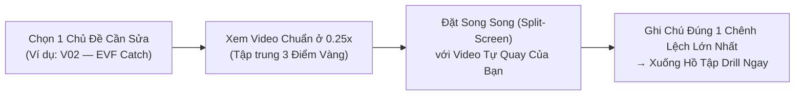

# Danh Mục Video Tham Khảo & Khung Phân Tích Mẫu (*Reference Video Catalog*)

> **Thuộc phần:** `videos/` | **Trình độ:** Cơ bản → Nâng cao | **Thời gian đọc:** ~10 phút

## Tổng Quan (Overview)
Học bơi sải nhanh gấp 3 lần khi bạn kết hợp **đọc nguyên lý khoa học** với **quan sát hình ảnh chuyển động quay chậm (Slow-Motion 0.25x)** của các VĐV chuẩn mực và so sánh song song với chính video của mình. Tài liệu này đóng vai trò **thư viện tra cứu danh mục video chuẩn (Catalog)** — hướng dẫn chính xác *cần tìm xem video nào*, *dừng ở giây nào* và *soi đúng chi tiết cơ sinh học nào* cho từng chủ đề của bộ sách.

- **Mục tiêu cốt lõi:** Xây dựng thói quen "xem video có chủ đích" (*Deliberate Visual Learning*) — mỗi lần xem đều có danh sách 3 điểm cần quan sát rõ ràng.
- **Cảm giác đúng:** Khi xem một VĐV Olympic bơi quay chậm dưới nước, bạn lập tức nhận diện được góc EVF `110°`, điểm vào nước 11h/1h, hõm sóng mũi *Bow Wave* và nhịp chuyển `2 → 6-beat`.
- **Sai lầm phổ biến nhất:** Xem video thi đấu trên TV ở tốc độ thực (1x) góc quay trên cao — quá nhanh và không thấy được phần tạo lực quan trọng nhất ở dưới mặt nước!

---

## Lý Thuyết (Theory)
Trong khoa học thần kinh vận động, hệ thống **Nơ-ron Gương (*Mirror Neuron System*)** kích hoạt chính các vùng vỏ não vận động khi bạn **quan sát kỹ lưỡng một chuyển động chuẩn ở tốc độ chậm (`0.25x–0.5x`)** ngay trước khi xuống hồ tập luyện!
Để tối đa hóa hiệu ứng Nơ-ron Gương, danh mục video được phân thành **4 nhóm chuẩn**:
1. **Nhóm A — Video Kỹ Thuật Dưới Nước (Underwater Technical Clips)**: Soi từng pha tư thế, EVF, Push, Recovery, Kicking.
2. **Nhóm B — Video Hệ Thống Drill Chuẩn (Drill Demonstrations)**: Quan sát đúng nhịp độ và cảm giác của 9 bài Drill kinh điển.
3. **Nhóm C — Video Thi Đấu Olympic Phân Tích Dưới Nước (Olympic Underwater Race Footage)**: Học chiến thuật của Dressel, Popovici, Ledecky, Thorpe, Sun Yang.
4. **Nhóm D — Thư Viện Video Cá Nhân (*My Progress Archive*)**: Lưu trữ video tự quay của chính bạn ở Tuần 1, 8, 16, 20, 24.

---

## Cơ Sở Khoa Học (Science)
### Vật Lý & Thủy Động Lực Học (Physics & Hydrodynamics)
Khi xem video quay chậm dưới nước (`0.25x`), hãy tập trung theo dõi **dòng bọt khí làm chất chỉ thị dòng chảy (*Flow Visualization*)**:
- Dải bọt mảnh, khép gọn dọc thân và tan nhanh → **Lực cản thấp ($C_d$ nhỏ)**.
- Chùm bọt lớn bao kín bàn tay và cẳng tay lúc bắt nước → **Đập tay khi Entry làm mất bám nước**.
- Vòng xoáy tròn sắc nét tách ra ngang đùi ở cuối pha Push → **Vortex Shedding tạo xung lượng đẩy tối đa**.

### Cơ Sinh Học (Biomechanics) — Danh Mục Video Tham Khảo Chuẩn Theo Chủ Đề

| Mã | Chủ đề | Từ khóa tìm kiếm chuẩn (YouTube / World Aquatics / SwimSmooth) | Góc quay cần xem | 3 Điểm Vàng Cần Soi Khi Dừng Khung Hình |
| :-: | :--- | :--- | :--- | :--- |
| `V01` | **Body Position & Streamline** | `"Underwater Freestyle Body Position Alignment Slow Motion"` | Side Underwater | Đường nước qua đỉnh trán; góc thân `< 5°`; bắp tay khóa sau tai |
| `V02` | **EVF High Elbow Catch** | `"Early Vertical Forearm EVF Underwater Slow Motion Freestyle"` | Side + Front UW | Khuỷu cao cố định; cẳng tay dựng `100–120°`; cổ tay không bẻ ngược |
| `V03` | **One-Goggle Breathing** | `"Swim Smooth Bow Wave Breathing Underwater"` | Front Waterline | 1 mắt kính chạm nước; tay trượt giữ sâu `10–15 cm`; úp mặt trước khi tay chạm nước |
| `V04` | **2-Beat / 4-Beat / 6-Beat Kick** | `"2 Beat vs 6 Beat Kick Underwater Slow Motion"` | Side Underwater | Đạp từ hông; gối mềm `155°`; cổ chân duỗi `170°+`; ít bọt mặt nước |
| `V05` | **Underwater Dolphin Kick** | `"Caeleb Dressel Underwater Dolphin Kick Slow Motion"` | Side Underwater | Tay & đầu bất động `< 4 cm`; sóng phát từ ngực–hông; quất mạnh cả pha kéo lên (*Upkick*) |
| `V06` | **David Popovici (DPS & Nhẹ Tay)** | `"David Popovici 200m Freestyle Underwater Analysis"` | Side + Above | Vào nước không bọt; Front-Quadrant siêu dài; pha Recovery mềm mại |
| `V07` | **Katie Ledecky (Đường Dài)** | `"Katie Ledecky Chocolate Milk Challenge + 1500m Underwater"` | Front + Side UW | Đỉnh đầu đứng yên 0 cm; thở 1:2 dứt khoát; nhịp tay cao không Dead Spot |
| `V08` | **Flip Turn Chuẩn** | `"Olympic Freestyle Flip Turn Underwater Slow Motion"` | Side Underwater (0–10m) | Không thở sau chữ T; cuộn bóng chặt; khóa Streamline trước khi chân đạp bật |
| `V09` | **Open Water Sighting & Drafting** | `"Swim Smooth Alligator Eyes Sighting & Drafting"` | Waterline Front | Chỉ nhô mắt 0.3s → xoay ngang thở; bám sát chân `20–50 cm` |

---

## Thực Hành (Practical)
### Tại Sao Kỹ Thuật Này Hiệu Quả (Why It Works)
Chỉ cần dành **`3 phút` xem lại đúng 1 đoạn video mẫu `V01–V09`** trên điện thoại **ngay trước khi xuống hồ bơi** (trong lúc làm nóng cạn), hình ảnh vận động chuẩn sẽ ở trạng thái "tươi mới nhất" trong vỏ não — giúp bạn mô phỏng góc khuỷu và nhịp xoay chính xác hơn rõ rệt ngay từ chiều bể đầu tiên!

### Hướng Dẫn Từng Bước (Step-by-Step) — Quy Ước Lưu Trữ Thư Viện Cá Nhân (`videos/my-progress/`)

Tạo thư mục lưu trữ cục bộ (không đẩy file `.mp4` nặng lên Git, chỉ lưu ghi chú Markdown hoặc link đám mây) theo quy ước:
- `W01_Baseline/` — 4 góc quay đầu vào Tuần 01.
- `W08_Block2_EVF/` — Kiểm định góc EVF & Stroke Count sau Block 2.
- `W16_MidPlan_CSS/` — Kiểm định nhịp Opposition & DPS ở pace CSS.
- `W20_PreTaper_100m/` — Kiểm định Split & Flip Turn trước Taper.
- `W24_FinalTest/` — Video kỷ niệm chinh phục cột mốc `< 1:30/100m`!

<!-- IMAGE_PROMPT: Clean sports video analysis software UI mockup showing a side-by-side Split-Screen underwater comparison: Left panel "Reference Pro (EVF 110 deg, Body Tilt 3 deg)"; Right panel "Swimmer Progress W01 vs W16" with angle overlay arcs, timeline scrubber, and synchronized keyframe markers. -->

### Mẹo Nâng Cao (Advanced Tips)
- **Các kênh phân tích kỹ thuật bơi uy tín nhất toàn cầu nên theo dõi**:
  1. **The Race Club (Gary Hall Sr.)** — Phân tích cơ sinh học Olympic cực kỳ chi tiết.
  2. **Swim Smooth** — Thực chiến nhất cho người bơi phong trào, Triathlete & Open Water.
  3. **Effortless Swimming (Brenton Ford)** — Phân tích trực quan sửa lỗi cho hàng trăm người bơi phong trào.
  4. **World Aquatics / USA Swimming** — Thư viện góc quay dưới nước chuẩn HD/4K từ các giải vô địch thế giới.

---

## Bài Tập Thực Hành (Drills — Bài Tập Quan Sát Chủ Động)

| Bài Tập | Thời lượng | Quy trình |
| :--- | :---: | :--- |
| **Pre-Pool 3-Minute Visualization** | `3 phút` trước buổi bơi | Xem 1 clip quay chậm đúng bài Drill sắp tập (`0.5x`), nhắm mắt tưởng tượng mình thực hiện đúng cảm giác đó 5 lần |
| **Split-Screen Kinovea Audit** | `15 phút` cuối mỗi Block | Mở song song video `W01` và video mới nhất, đồng bộ đúng khung hình `Hand Entry` để thấy rõ tiến bộ |

---

## Phân Tích AI & Video (AI Analysis)
- **Chuẩn gắn thẻ tìm kiếm tự động (Video Tagging):** Mỗi video trong catalog cá nhân nên gắn thẻ `[week, angle, pace_zone, target_skill, key_error]` để dễ dàng truy xuất lại toàn bộ lịch sử tiến bộ 6 tháng.

---

## Lỗi Thường Gặp & Cách Sửa (Common Errors)
| Lỗi thường gặp | Triệu chứng nhận biết | Nguyên nhân gốc | Cách sửa (Correction) |
| :--- | :--- | :--- | :--- |
| **Xem quá nhiều video lý thuyết trái ngược nhau** | Bị rối loạn không biết nên kéo thẳng hay cong, thở 1:2 hay 1:3 | Xem lan man không theo hệ thống nhất quán | Bám sát đúng **1 lộ trình chuẩn** của `swim-book` & chỉ xem video khớp Block hiện tại |
| **Chỉ xem video ở tốc độ 1x** | Não không kịp nhận ra chi tiết dựng cổ tay và góc khuỷu EVF | Pha Catch diễn ra chỉ trong `0.2–0.3 giây` | Luôn bật tốc độ **`0.25x` hoặc bấm dừng từng khung hình (phím `.` và `,` trên YouTube)** |

---

## Tự Đánh Giá Tại Hồ (Self Assessment)
- [ ] Tôi biết cách bấm dừng từng khung hình và xem video dưới nước ở tốc độ `0.25x`.
- [ ] Tôi thực hành thói quen xem nhanh `2–3 phút` video mẫu đúng trọng tâm kỹ thuật trước khi xuống hồ.
- [ ] Tôi đã tạo thư mục lưu trữ video tiến bộ cá nhân theo mốc `W01 → W08 → W16 → W24`.

---

## Chỉ Số Đo Lường (KPI)
| Chỉ số áp dụng Video Learning | Mục tiêu |
| :--- | :---: |
| **Số đợt quay & đối chiếu Split-Screen trong 24 tuần** | `4–5 đợt` (Tuần 1, 8, 16, 20, 24) |
| **Thời gian xem video có chủ đích mỗi tuần** | `10–15 phút` (đúng trọng tâm Block) |

---

## Câu Hỏi Thường Gặp (FAQ)
**1. Phím tắt xem từng khung hình trên YouTube khi phân tích kỹ thuật bơi là gì?**
Khi video đang tạm dừng (*Pause*), bấm phím **`.` (dấu chấm)** để tiến tới đúng **1 khung hình**, và phím **`,` (dấu phẩy)** để lùi lại đúng **1 khung hình**! Đây là mẹo cực kỳ hữu ích để soi chính xác thời điểm *Hand Entry* và *EVF*.

**2. Tại sao không nên nhúng trực tiếp file `.mp4` dung lượng lớn vào kho Git Markdown này?**
Vì file video HD/4K nặng hàng trăm MB sẽ làm phình kho Git. Giải pháp chuẩn là lưu video trên Google Drive / ổ cứng ngoài và chỉ lưu **file Markdown ghi chú + JSON annotation + link tham chiếu** trong `videos/` và `datasets/`.

---

## Tóm Tắt (Summary)
- Danh mục `V01–V09` chuẩn hóa những video cần xem và **3 điểm vàng cần soi** ở tốc độ `0.25x` cho từng kỹ năng bơi sải.
- Kết hợp **xem nhanh 3 phút trước buổi bơi** với **đối chiếu Split-Screen mỗi 4–8 tuần** giúp tăng tốc độ sửa lỗi gấp nhiều lần.

**Liên kết chéo:**
- Chương trước: [Schema Dữ Liệu AI](../datasets/dataset-schema.md)
- Chương tiếp theo (Phase 11): [Bảng Tự Đánh Giá Tại Hồ](../23-checklists/self-evaluation.md)
- Tra cứu thuật ngữ: [Glossary](../24-appendix/glossary.md)

---

## Tài Liệu Tham Khảo (References)
1. Rizzolatti, G., & Craighero, L. (2004). *The mirror-neuron system*. Annual Review of Neuroscience.
2. Swim Smooth, The Race Club & Effortless Swimming Official Technical Libraries.
3. World Aquatics Underwater Race Analysis Archives.

